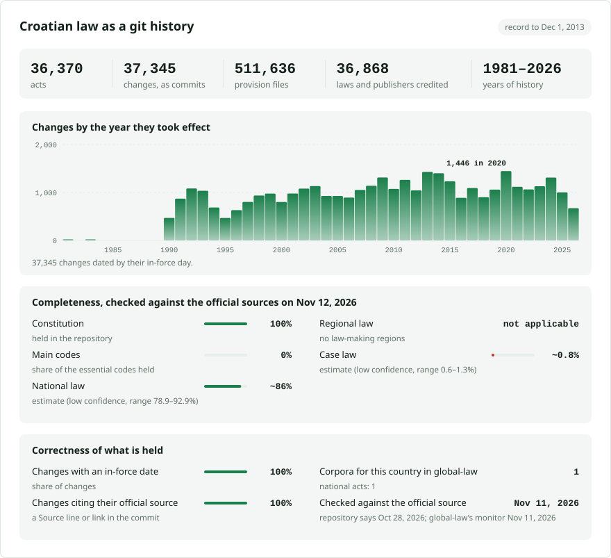

# Croatia: law history in git

**English** · **[Ili pročitajte na hrvatskom](README.md)**

<picture>
<source media="(prefers-color-scheme: dark)" srcset="data/effort-dark.svg">

</picture>

The law of Croatia as a git history: one file per article, one commit per version on the day it took effect, and the act that made each change as the commit's author. `git blame` names the act behind every line; `git log` lists every change to an article; picking a date gives the text in force that day.

Part of [lexifina/global-law](https://github.com/lexifina/global-law), one git history for every country's law: this is Croatia's national law, which global-law reads at `croatia/national/acts/`.

**What is in it now:** the Constitution with every change since 1990; 34,153 acts of the official part of Narodne novine since 1990 (3,200 laws, 3,881 Government decrees, 14,833 decisions, 10,386 rules and 1,853 orders, instructions and statutes), 7,121 of them amending acts, with 34,633 versions; 754 more laws as first published, from an earlier build; 1,141 Constitutional Court decisions; 1,175 international treaties; 122 collective agreements; 70 declarations, resolutions and conclusions of the Sabor; and 129 official election results. [`PLAN.md`](PLAN.md) lists every part this repository is meant to hold and how far each one is; [`registry/ACTS.md`](registry/ACTS.md) lists the acts by kind, and [`data/zakoni.json`](data/zakoni.json) the laws of the earlier build.

Each act is in `<kind>/<year>/<document number>/`, from its first publication in Narodne novine (`zakon/2022/2343/` is the Zakon o izmjenama i dopunama Zakona o radu, NN 151/2022); the Constitution is in [`ustav/`](ustav/) and the laws of the earlier build in `zakoni/<name>/` (`zakoni/zakon-o-radu/` is the Zakon o radu, the Labour Act, NN 93/2014). `registry/data/paths.json` maps each act id to its folder.

The text is in Croatian, as Narodne novine prints it. An English translation is not part of this record.

## Questions as git commands

| Question | Command |
| --- | --- |
| Every change to Article 62 of the Constitution | `git log -p --word-diff -- ustav/clanak-062.md` |
| Which act wrote each line of Article 62? | `git blame ustav/clanak-062.md` |
| Every version of the Constitution, with the day each took effect | `git log --format="%h %(trailers:key=In-force,valueonly,separator=) %an" -- ustav` |
| Article 62 as in force on 1 January 2012 | `python tools/ustav.py 2012-01-01 ustav 62` |

Any other act on a date: `python registry/tools/on.py 2025-06-01 zakon/2022/2343`.

**Outside git**, we also host this record publicly, for free:

- **[Ask Claude about Croatian law](https://global-law.lexifina.com/v1/try_claude?country=croatia)**: opens Claude with a first question ready.
- **[Ask ChatGPT](https://global-law.lexifina.com/v1/try_chatgpt?country=croatia)**: the same question in ChatGPT.
- **[Search Croatian law on our site](https://lexifina.com/law?country=croatia&q=godi%C5%A1nji+odmor)**: a search for "godišnji odmor", with each provision's text and its versions, no account needed.
- **[Developer REST API](https://global-law.lexifina.com/v1/search_law?query=godi%C5%A1nji+odmor&jurisdiction=croatia)**: the same search as JSON, with no key. See the [documentation here](https://lexifina.com/api/global-law).

Both assistants read the record through the free Global law connector (MCP, `https://global-law.lexifina.com/mcp`); the first time, the chat gives you the link that adds it. Ask in Croatian or in English.

**Host it yourself easily.** All it takes is git and Python, and the tools run on your machine:

```sh
git clone --depth 1 https://github.com/lexifina/global-law && cd global-law
python3 tools/countries.py add croatia/national/acts
python3 tools/law.py show 2026-01-01 croatia/national/acts/ustav/clanak-062.md
```

Opened in Claude Code, Cursor, VS Code or Codex, the clone also starts a local MCP server with the same tools ([MCP.md](https://github.com/lexifina/global-law/blob/main/MCP.md)).

## Dates

Each commit is dated at noon, Europe/Zagreb, on the day the version took effect, and carries it in its `In-force:` trailer; the days the act was enacted and published are the `Enacted:` and `Published:` trailers:

- for an act as first printed, the day its own entry-into-force clause gives ("osmoga dana od dana objave", a date). The default of Article 90 of the Constitution (no earlier than the eighth day after publication) is not applied: an act whose day cannot be read is held back, not guessed;
- for a later version, taken from an official consolidated text (pročišćeni tekst), the day the latest change it covers took effect; versions in between are not carried;
- for an act repealed as a whole, an empty last version on the day the repeal takes effect;
- for the Constitution, the day each amending act's own wording gives, quoted in the `Evidence:` trailer; the day of accession to the EU (1 July 2013) comes from the Treaty of Accession.

Each act's first version is credited to the act itself (`Zakon o Hrvatskoj radio-televiziji (NN 28/1990)`) and its repeal to the repealing act; a version from an official consolidated text is credited to Narodne novine (61 versions), since the text covers several acts and does not say which changed what. The Constitution's changes are credited to the amending act (`NN 113/2000`), the laws of the earlier build to Lexifina, which is the committer throughout.

## How current it is

- `python tools/freshness.py <act>`: an act's status, its last check against Narodne novine and its official link
- [data/status.json](data/status.json): whether updates are running and when Narodne novine last answered
- [data/pending.json](data/pending.json): acts published but not yet in force, each added on the day it takes effect

## How it is checked

- The Constitution: `tools/check_repo.py` reads every version back from git and compares it with the official Narodne novine page, file by file and word for word; a second build gave the same hashes ([`REPRODUCE.md`](REPRODUCE.md)).
- Every other act's versions name the Narodne novine page they were read from (`Source:`); `registry/tools/build/check_repo.py` reads every version back from git and compares it with the corpus it was built from ([`registry/REPRODUCE.md`](registry/REPRODUCE.md)).
- Every act is checked against everything Narodne novine has published since it, for the acts that amend, repeal, replace or cite it ([data/freshness.json](data/freshness.json)).

## What it does not show

- **Most acts as amended.** Narodne novine publishes official consolidated texts for few acts, so an act changed later is held as first printed and labelled (`amended, not consolidated`, `repealed, not consolidated` and the like), with the acts that change it named in its README; their changes are not applied to its text.
- **12,001 acts held back** ([data/held.json](data/held.json)): 4,466 with pictures, 4,815 whose in-force day is missing or cannot be read, and the rest because their pages do not read cleanly into articles.
- **Local acts.** None yet: the City of Zagreb, 20 counties, 127 cities and 428 municipalities each publish their own gazette (see `PLAN.md`).
- **Other case law.** Only Constitutional Court decisions published in Narodne novine are here.
- **Law before 1990** (of SR Hrvatska, and the federal laws taken over in 1991) is planned (see `PLAN.md`).
- **The Constitution's own amending words.** Its versions are the consolidated texts the Sabor's Constitution Committee published, numbered as each one is, so `ustav/clanak-062.md` is not the same provision in every version.

## Sources

| Source | Kind | Past versions | Notes |
| --- | --- | --- | --- |
| [Narodne novine](https://narodne-novine.nn.hr), službeni dio (Narodne novine d.d.) | Official gazette | where an official consolidated text (pročišćeni tekst) is published | Every act as first printed, at its ELI address, and the documents that change it; only the printed Narodne novine is authoritative |
| [Narodne novine](https://narodne-novine.nn.hr), međunarodni ugovori | Official gazette, international part | as published | Treaties, in the acts that ratify or publish them |

## Licence

See [`LICENSE`](LICENSE). Narodne novine's terms of use say its content may be used only under the conditions the law prescribes and give no licence to republish it; `registry/REPRODUCE.md` relies on the Copyright Act (ZAPSP, čl. 18. st. 3.), under which official texts are not protected. `LICENSE` grants no licence for the law text, the history or the tools until that question is settled.

No AI model wrote or changed legal text; the scripts were written by an AI model (see [`REPRODUCE.md`](REPRODUCE.md) and [`registry/REPRODUCE.md`](registry/REPRODUCE.md)).

## More

From [lexifina/global-law](https://github.com/lexifina/global-law):

- [FEATURES.md](https://github.com/lexifina/global-law/blob/main/FEATURES.md): every feature, and what every corpus must support (`git blame`, `law.py`, the MCP tools)
- [FAQ.md](https://github.com/lexifina/global-law/blob/main/FAQ.md): questions and answers · [CONTRIBUTING.md](https://github.com/lexifina/global-law/blob/main/CONTRIBUTING.md): proposing changes · [MCP.md](https://github.com/lexifina/global-law/blob/main/MCP.md): the MCP server · [REPRODUCE.md](https://github.com/lexifina/global-law/blob/main/REPRODUCE.md): how it was built · [CHANGELOG.md](https://github.com/lexifina/global-law/blob/main/CHANGELOG.md)
- [FRESHNESS.md](https://github.com/lexifina/global-law/blob/main/FRESHNESS.md): how current each corpus is · [Monitoring](https://github.com/lexifina/global-law/tree/main/monitoring): whether updates are running · [WATCHING.md](https://github.com/lexifina/global-law/blob/main/WATCHING.md): how each official source is watched for changes
- [performance/](https://github.com/lexifina/global-law/tree/main/performance): how fast the tools are, measured
- [visualisations/](https://github.com/lexifina/global-law/tree/main/visualisations): charts and bridges across the world's law
- [Vulnerabilities](https://github.com/lexifina/global-law/tree/main/vulnerabilities): mistakes in legislation as published
