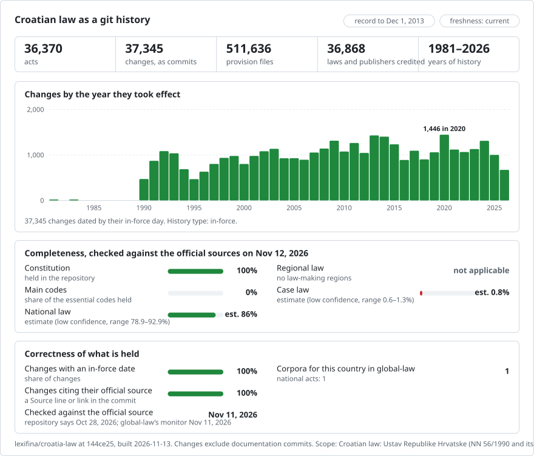

# Croatia: law history in git

<picture>
<source media="(prefers-color-scheme: dark)" srcset="data/effort-dark.svg">

</picture>

Part of [lexifina/global-law](https://github.com/lexifina/global-law), one git history for every country's law: this is Croatia's national law, which global-law reads at `croatia/national/acts/`.

**Private. Reuse conditions are unclear** (see `LICENSE`); do not publish.

**Scope**
- The Constitution of the Republic of Croatia (Ustav Republike Hrvatske) with every change, from the official texts
  (`ustav/`, below).
- The acts of the official part of Narodne novine (službeni dio): laws (zakoni), Government decrees (uredbe), rules
  (pravilnici), decisions (odluke), orders (naredbe), instructions (naputci, upute) and statutes (statuti), each as
  first printed in Narodne novine, dated by its own entry-into-force sentence and credited to itself. Decisions about
  named people, Constitutional Court decisions, corrections (Ispravak) and collective agreements are not published as
  acts.
- Acts that later documents change are published as enacted and labelled (`amended, not consolidated` and the like),
  with the documents that change them: Narodne novine publishes official consolidated texts (pročišćeni tekst) for only
  a few acts.

**Status**
- Narodne novine is read back year by year; acts are published once every later issue has been read, so the record
  grows backwards in time. Acts held back, with the reason, are listed in [data/held.json](data/held.json); acts
  published but not yet in force in [data/pending.json](data/pending.json).
- `zakoni/` holds laws in force as first published (added from November 2026 by an earlier builder);
  [data/zakoni.json](data/zakoni.json) gives each its status (`in force`, `amended, not consolidated`,
  `repealed, not consolidated`, ...) and the acts that changed it since.

## Layout

| Where | What |
| --- | --- |
| `ustav/` | the Constitution: the text as proclaimed (NN 56/1990) and the consolidated texts after each change |
| `zakoni/<slug>/` | laws in force, the text as first published ([data/zakoni.json](data/zakoni.json): status and later changes) |
| `zakon/`, `uredba/`, `pravilnik/`, `odluka/`, `naredba/`, `naputak/`, `uputa/`, `statut/` | the acts of the official part, by kind, year and Narodne novine document number: `pravilnik/2024/100/` |
| `<act>/clanak-NNN.md` · `<act>/README.md` | one article per file · the act's versions, status and notes |
| [registry/ACTS.md](registry/ACTS.md) · [registry/data/](registry/data/) | the act list, and the act tables ([registry/data/acts.json](registry/data/acts.json): kind, number, status, `amended_by`, official page) |
| `data/` · `tools/` | freshness, status and held/pending lists · the tools below |

## Use it

| Question | Command |
| --- | --- |
| What did čl. 62 of the Constitution say on 1 January 2012? | `python tools/ustav.py 2012-01-01 ustav 62` |
| An act as it stood on a day | `python registry/tools/on.py 2025-06-01 pravilnik/2024/100` |
| Which act wrote each paragraph of an article? | `git blame ustav/clanak-062.md` |
| Every change to an article | `git log --follow -p --word-diff ustav/clanak-062.md` |
| Is an act here current? | `python tools/freshness.py pravilnik-2024-100` |

Read dates with the tools, not `git rev-list --before`: they pick each version by its `In-force:` trailer.

## How current is it

Every version names the official page it was read from (`Source:`), so every act can be checked against its source.

<!-- freshness-summary -->
Checked against the official sources: 2026-11-11; 100% of acts verified in the last 7 days, 100% in the last 30 ([data/freshness.json](data/freshness.json)).
<!-- /freshness-summary -->

`python tools/freshness.py <act>` gives an act's status, its last check and the official link. A refresh runs every
day: it reads every new issue of Narodne novine, publishes the new acts and re-checks every act against everything
published since it; [data/status.json](data/status.json) says whether updates are running and when Narodne novine last
answered. Acts older than the year the read of Narodne novine has reached are `unverified` until it gets there
(`read_back_to_year` in [data/freshness.json](data/freshness.json)). Statuses and fields: [data/freshness.json](data/freshness.json).

## Dates, authors and limits

- Each commit is dated at noon in Zagreb on the day the change took effect; the author is the act that made it, the
  committer Lexifina. The publication and adoption days are trailers.
- An act's in-force day is read from its own entry-into-force sentence ("stupa na snagu danom objave", "osmoga dana od
  dana objave", a date); an act whose sentence cannot be read is held back, not guessed.
- An act marked `amended, not consolidated` (or `repealed`, `replaced`, `cited later`, `not consolidated`) holds the act
  as published and names the documents that change it; later amendments are not applied to its text.
- Only the printed Narodne novine is authoritative.

## The Constitution (ustav/)

The Constitution as a git repository. Each amending act is one commit, credited to that act and dated the day it took
effect, at noon in Zagreb. The text is the official text published in [Narodne novine](https://narodne-novine.nn.hr):
the Constitution as first published (NN 56/1990) and the consolidated texts ("pročišćeni tekst") the Sabor's
Constitution Committee published after each change.

### The dates, and which one we use

Each act has the day it was enacted (`Enacted:`), the day it was published in Narodne novine (`Published:`) and the day it
took effect (`In-force:`). **Commits are dated the day the change took effect**, at noon in Zagreb (CET, or CEST in summer
time). The in-force day is read from the act's own wording ("stupa na snagu danom objave", "danom proglašenja", "kad ju
proglasi Zastupnički dom") and the wording is quoted in the `Evidence:` trailer. The one day the wording does not give
(the accession of Croatia to the EU) is taken from the Treaty of Accession and says so. All dates are 1970 or later.

### What "author" means

The author of a commit is the act that made the change: `NN 113/2000`, with an address ending `@narodne-novine.invalid`, so
`git blame` names the act. The committer is always `Lexifina`.

### The commits

| Day | Author | What |
| --- | --- | --- |
| 1990-12-22 | NN 56/1990 | The Constitution as proclaimed |
| 1997-12-15 | NN 135/1997 | Ustavni zakon o izmjenama i dopunama (text of the consolidated NN 8/1998) |
| 2000-11-09 | NN 113/2000 | Promjena Ustava (text of the consolidated NN 124/2000) |
| 2001-03-28 | NN 28/2001 | Promjena Ustava (text of the consolidated NN 41/2001, as printed) |
| 2001-03-28 | NN 55/2001 (ispravak) | The Ispravak of the NN 41/2001 text; derived, labelled |
| 2010-06-16 | NN 76/2010 | Promjena Ustava (text of the consolidated NN 85/2010) |
| 2013-07-01 | NN 76/2010 | Staged commencement: the EU provisions take effect; no file changes |
| 2013-12-01 | NN 5/2014 (referendum 2013) | The fifth change, by referendum: čl. 62 gets a new stavak 2; derived, labelled |

### What it does not show, and what is labelled

- **Consolidated texts, not the acts' own words.** Each version's text is the Committee's consolidated text. The act says
  "čl. 35. mijenja se i glasi"; the consolidated text is the result. A consolidated text can carry editorial corrections
  that the act does not state (punctuation, wording), and we do not separate them: every difference between two
  consecutive texts is credited to the act whose consolidated text it is, and each commit carries a `Label:` saying so.
- **Numbers move.** Articles are numbered as in each consolidated text; a change that adds an article renumbers the rest, so
  `clanak-062.md` is not always the same provision across 2000 or 2010, and `git log --follow` on a file follows a number,
  not a provision. (The Constitutional Court notes the same: what the 2013 change calls article 62 is article 61 in the
  text as proclaimed.) The 1990 page of Narodne novine is a transcription with a few typographical oddities, kept as
  published.
- **2001-03-28, the Ispravak (NN 55/2001).** The NN 41/2001 text had four misprints; the Ispravak lists them. The first
  commit of that day is the NN 41/2001 text as printed; the second applies the four corrections by a script that checks
  every word it uses against the Ispravak page. Its `In-force` is the day of the Promjena it corrects.
- **2010-06-16 and 2013-07-01.** NN 76/2010 took effect on proclamation (16 June 2010) except some provisions that take
  effect on accession to the EU. The NN 85/2010 text prints them all; they are in the 2010-06-16 commit, labelled as
  printed early, and the 2013-07-01 commit (no file changes) records the day they took effect.
- **2013-12-01.** Narodne novine published no consolidated text after the 2013 referendum, and no act: the Constitutional
  Court's decision (NN 5/2014, 93) declares the change in force on 1 December 2013, quoting the amendment. The commit is the
  NN 85/2010 text with that one sentence inserted as čl. 62 stavak 2 by a script. It is derived and labelled.
- The record ends 2013-12-01: no later change to the Constitution is known to us. The consolidated texts are
  informational; only the printed Narodne novine is authoritative.

### Files

`ustav/izvorisne-osnove.md` is the preamble; `ustav/clanak-NNN.md` is one article. The `#` line is the article number;
`##` lines above it are the part or chapter headings that open there; every other line is one paragraph (stavak), and
list items keep their dash.

### How it is checked, and built

`tools/check_repo.py` reads every version back from git on its in-force day and compares it with the official page, file by
file and word for word; `tools/test_repo.py` runs the commands above. `tools/build.py` writes the repository from the
cached official pages and gives the same hashes. [`REPRODUCE.md`](REPRODUCE.md) has every source, step, the software and
what an AI model did (it wrote the build tools; it wrote no legal text and no model runs at build time).
[`corpus.json`](corpus.json) describes the corpus for global-law.
