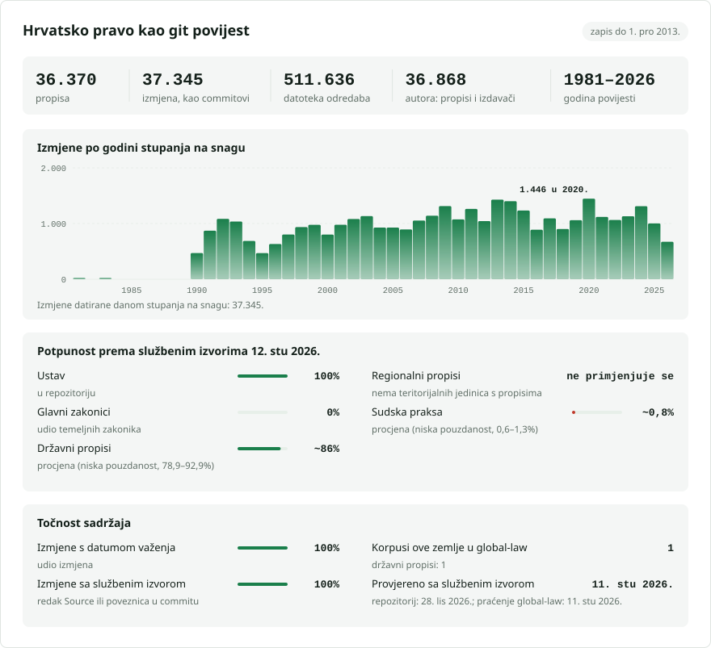

# Hrvatska: povijest propisa u gitu

**Hrvatski** · **[Or read it in English](README.en.md)**

<picture>
<source media="(prefers-color-scheme: dark)" srcset="data/hr/effort-dark.svg">

</picture>

Pravo Hrvatske kao git povijest: jedna datoteka po članku, jedan commit po verziji na dan kad je stupila na snagu, a autor svakog commita je akt koji je unio promjenu. `git blame` za svaki redak navodi akt koji stoji iza njega; `git log` navodi svaku promjenu članka; odabirom datuma dobiva se tekst koji je toga dana bio na snazi.

Dio projekta [lexifina/global-law](https://github.com/lexifina/global-law), jedinstvene git povijesti prava svih država: ovo je hrvatsko nacionalno pravo, koje global-law čita na putanji `croatia/national/acts/`.

**Što sadrži sada:** Ustav sa svim promjenama od 1990.; 34.153 akta službenog dijela Narodnih novina od 1990. (3.200 zakona, 3.881 uredbu Vlade, 14.833 odluke, 10.386 pravilnika te 1.853 naredbe, naputka, upute i statuta), od toga 7.121 akt kojim se mijenja drugi akt, s 34.633 verzije; još 754 zakona onako kako su prvi put objavljeni, iz ranije izrade; 1.141 odluku Ustavnog suda; 1.175 međunarodnih ugovora; 122 kolektivna ugovora; 70 deklaracija, rezolucija i zaključaka Hrvatskoga sabora; i 129 službenih rezultata izbora. [`PLAN.md`](PLAN.md) navodi sve dijelove koje ovaj repozitorij treba sadržavati i dokle se stiglo sa svakim; [`registry/ACTS.md`](registry/ACTS.md) navodi akte po vrsti, a [`data/zakoni.json`](data/zakoni.json) zakone iz ranije izrade.

Svaki je akt u `<vrsta>/<godina>/<broj dokumenta>/`, prema prvoj objavi u Narodnim novinama (`zakon/2022/2343/` je Zakon o izmjenama i dopunama Zakona o radu, NN 151/2022); Ustav je u [`ustav/`](ustav/), a zakoni iz ranije izrade u `zakoni/<naziv>/` (`zakoni/zakon-o-radu/` je Zakon o radu, NN 93/2014). `registry/data/paths.json` povezuje id svakog akta s njegovom mapom.

Tekst je na hrvatskom, onako kako ga tiskaju Narodne novine. Prijevod na engleski nije dio ovog zapisa.

## Pitanja kao git naredbe

| Pitanje | Naredba |
| --- | --- |
| Svaka promjena članka 62. Ustava | `git log -p --word-diff -- ustav/clanak-062.md` |
| Koji je akt napisao svaki redak članka 62.? | `git blame ustav/clanak-062.md` |
| Svaka verzija Ustava, s danom kad je stupila na snagu | `git log --format="%h %(trailers:key=In-force,valueonly,separator=) %an" -- ustav` |
| Članak 62. u tekstu na snazi 1. siječnja 2012. | `python tools/ustav.py 2012-01-01 ustav 62` |

Bilo koji drugi akt na određeni dan: `python registry/tools/on.py 2025-06-01 zakon/2022/2343`.

**Izvan gita** ove podatke također objavljujemo javno i besplatno:

- **[Pitajte Claude o hrvatskom pravu](https://global-law.lexifina.com/v1/try_claude?country=croatia)**: otvara Claude sa spremnim prvim pitanjem.
- **[Pitajte ChatGPT](https://global-law.lexifina.com/v1/try_chatgpt?country=croatia)**: isto pitanje u ChatGPT-u.
- **[Pretražite hrvatsko pravo na našoj stranici](https://lexifina.com/law?country=croatia&q=godi%C5%A1nji+odmor)**: pretraga za „godišnji odmor”, s tekstom svake odredbe i njezinim verzijama, bez računa.
- **[REST API za programere](https://global-law.lexifina.com/v1/search_law?query=godi%C5%A1nji+odmor&jurisdiction=croatia)**: ista pretraga kao JSON, bez ključa. Dokumentacija je [ovdje](https://lexifina.com/api/global-law).

Oba asistenta čitaju podatke putem besplatnog konektora Global law (MCP, `https://global-law.lexifina.com/mcp`); prvi put razgovor daje poveznicu kojom se konektor dodaje. Pitajte na hrvatskom ili na engleskom.

**Lako ga pokrenite sami.** Dovoljni su git i Python, a alati rade na vašem računalu:

```sh
git clone --depth 1 https://github.com/lexifina/global-law && cd global-law
python3 tools/countries.py add croatia/national/acts
python3 tools/law.py show 2026-01-01 croatia/national/acts/ustav/clanak-062.md
```

Otvoren u Claude Codeu, Cursoru, VS Codeu ili Codexu, klon pokreće i lokalni MCP poslužitelj s istim alatima ([MCP.md](https://github.com/lexifina/global-law/blob/main/MCP.md)).

## Datumi

Svaki je commit datiran u podne po zagrebačkom vremenu (Europe/Zagreb), na dan kad je verzija stupila na snagu, i taj dan nosi u traileru `In-force:`; dan donošenja i dan objave akta su traileri `Enacted:` i `Published:`:

- za akt kako je prvi put tiskan, dan koji navodi njegova vlastita odredba o stupanju na snagu („osmoga dana od dana objave”, datum). Opće pravilo članka 90. Ustava (najranije osmoga dana od dana objave) ne primjenjuje se: akt čiji se dan ne može pročitati zadržava se, a ne pogađa se;
- za kasniju verziju, preuzetu iz službenog pročišćenog teksta, dan kad je stupila na snagu posljednja promjena koju taj tekst obuhvaća; verzije između njih nisu unesene;
- za akt ukinut u cijelosti, prazna posljednja verzija na dan kad ukidanje stupa na snagu;
- za Ustav, dan koji navodi tekst svakog akta o promjeni, citiran u traileru `Evidence:`; dan pristupanja Europskoj uniji (1. srpnja 2013.) uzet je iz Ugovora o pristupanju.

Prva verzija svakog akta pripisana je samom aktu (`Zakon o Hrvatskoj radio-televiziji (NN 28/1990)`), a njegovo ukidanje aktu koji ga ukida; verzija iz službenog pročišćenog teksta pripisana je Narodnim novinama (61 verzija), jer tekst obuhvaća više akata i ne kaže koji je što promijenio. Promjene Ustava pripisane su aktu o promjeni (`NN 113/2000`), a zakoni iz ranije izrade Lexifini, koja je i committer svih commitova.

## Koliko je ažurno

Provjereno prema službenim izvorima: 2026-11-11; 100 % akata provjereno u posljednjih 7 dana, 100 % u posljednjih 30 ([data/freshness.json](data/freshness.json)).

- `python tools/freshness.py <act>`: status akta, njegova posljednja provjera prema Narodnim novinama i službena poveznica
- [data/status.json](data/status.json): rade li ažuriranja i kada su Narodne novine posljednji put odgovorile
- [data/pending.json](data/pending.json): akti koji su objavljeni, ali još nisu na snazi; svaki se dodaje na dan kad stupi na snagu

## Kako se provjerava

- Ustav: `tools/check_repo.py` čita svaku verziju natrag iz gita i uspoređuje je sa službenom stranicom Narodnih novina, datoteku po datoteku i riječ po riječ; druga izrada dala je iste hasheve ([`REPRODUCE.md`](REPRODUCE.md)).
- Verzije svih drugih akata navode stranicu Narodnih novina s koje su pročitane (`Source:`); `registry/tools/build/check_repo.py` čita svaku verziju natrag iz gita i uspoređuje je s korpusom iz kojeg je izrađena ([`registry/REPRODUCE.md`](registry/REPRODUCE.md)).
- Svaki se akt provjerava prema svemu što su Narodne novine objavile nakon njega, tražeći akte koji ga mijenjaju, ukidaju, zamjenjuju ili citiraju ([data/freshness.json](data/freshness.json)).

## Što ne prikazuje

- **Većinu akata s unesenim izmjenama.** Narodne novine objavljuju službene pročišćene tekstove za malo akata, pa se akt koji je kasnije mijenjan čuva onako kako je prvi put tiskan i označen je (`amended, not consolidated`, `repealed, not consolidated` i slično), a akti koji ga mijenjaju navedeni su u njegovu README-u; njihove izmjene nisu unesene u njegov tekst.
- **12.001 zadržani akt** ([data/held.json](data/held.json)): 4.466 sa slikama, 4.815 čiji dan stupanja na snagu nedostaje ili se ne može pročitati, a ostali jer se njihove stranice ne mogu čisto raščlaniti na članke.
- **Lokalne propise.** Zasad nijedan: Grad Zagreb, 20 županija, 127 gradova i 428 općina imaju svaki svoje službeno glasilo (vidi `PLAN.md`).
- **Drugu sudsku praksu.** Ovdje su samo odluke Ustavnog suda objavljene u Narodnim novinama.
- **Pravo prije 1990.** (SR Hrvatske i savezni zakoni preuzeti 1991.) planirano je (vidi `PLAN.md`).
- **Vlastite riječi akata o promjeni Ustava.** Verzije Ustava su pročišćeni tekstovi koje je objavio saborski Odbor za Ustav, numerirani kako je numeriran svaki od njih, pa `ustav/clanak-062.md` nije ista odredba u svakoj verziji.

## Izvori

| Izvor | Vrsta | Ranije verzije | Napomene |
| --- | --- | --- | --- |
| [Narodne novine](https://narodne-novine.nn.hr), službeni dio (Narodne novine d.d.) | Službeni list | gdje je objavljen službeni pročišćeni tekst | Svaki akt kako je prvi put tiskan, na svojoj ELI adresi, i dokumenti koji ga mijenjaju; mjerodavne su samo tiskane Narodne novine |
| [Narodne novine](https://narodne-novine.nn.hr), međunarodni ugovori | Službeni list, međunarodni dio | onako kako su objavljeni | Ugovori, u aktima kojima se potvrđuju ili objavljuju |

## Licencija

Vidi [`LICENSE`](LICENSE). Opći uvjeti korištenja Narodnih novina kažu da se njihov sadržaj smije koristiti samo pod uvjetima propisanima zakonom i ne daju dozvolu za ponovnu objavu; `registry/REPRODUCE.md` oslanja se na Zakon o autorskom pravu i srodnim pravima (ZAPSP, čl. 18. st. 3.), prema kojem službeni tekstovi nisu zaštićeni. `LICENSE` ne daje nikakvu licenciju za tekst propisa, povijest ni alate dok se to pitanje ne riješi.

Nijedan model umjetne inteligencije nije pisao ni mijenjao tekst propisa; skripte je napisao model umjetne inteligencije (vidi [`REPRODUCE.md`](REPRODUCE.md) i [`registry/REPRODUCE.md`](registry/REPRODUCE.md)).

Ovo je prijevod engleske verzije ([README.en.md](README.en.md)); ako se razlikuju, mjerodavna je engleska verzija.

## Više

Iz repozitorija [lexifina/global-law](https://github.com/lexifina/global-law) (na engleskom):

- [FEATURES.md](https://github.com/lexifina/global-law/blob/main/FEATURES.md): sve funkcije i što svaki korpus mora podržavati (`git blame`, `law.py`, MCP alati)
- [FAQ.md](https://github.com/lexifina/global-law/blob/main/FAQ.md): pitanja i odgovori · [CONTRIBUTING.md](https://github.com/lexifina/global-law/blob/main/CONTRIBUTING.md): predlaganje izmjena · [MCP.md](https://github.com/lexifina/global-law/blob/main/MCP.md): MCP poslužitelj · [REPRODUCE.md](https://github.com/lexifina/global-law/blob/main/REPRODUCE.md): kako je izrađen · [CHANGELOG.md](https://github.com/lexifina/global-law/blob/main/CHANGELOG.md)
- [FRESHNESS.md](https://github.com/lexifina/global-law/blob/main/FRESHNESS.md): koliko je ažuran svaki korpus · [Praćenje](https://github.com/lexifina/global-law/tree/main/monitoring): rade li ažuriranja · [WATCHING.md](https://github.com/lexifina/global-law/blob/main/WATCHING.md): kako se svaki službeni izvor prati zbog izmjena
- [performance/](https://github.com/lexifina/global-law/tree/main/performance): koliko su alati brzi, izmjereno
- [visualisations/](https://github.com/lexifina/global-law/tree/main/visualisations): grafikoni i veze kroz pravo cijelog svijeta
- [Ranjivosti](https://github.com/lexifina/global-law/tree/main/vulnerabilities): pogreške u propisima onako kako su objavljeni
