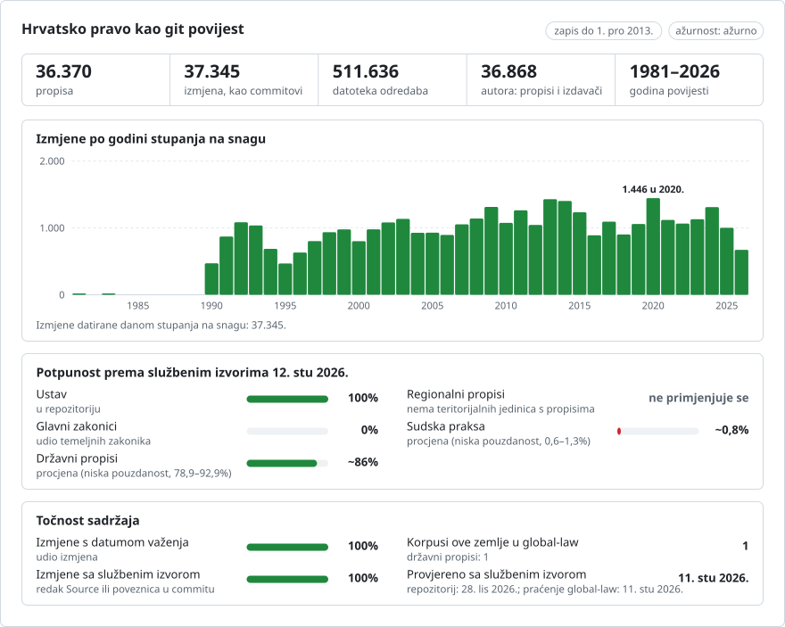

# Hrvatska: povijest propisa u gitu

**Hrvatski** · [English](README.en.md)

<picture>
<source media="(prefers-color-scheme: dark)" srcset="data/hr/effort-dark.svg">

</picture>

Dio repozitorija [lexifina/global-law](https://github.com/lexifina/global-law), jedinstvene git povijesti prava svih država: ovo je hrvatsko nacionalno pravo, koje global-law čita iz `croatia/national/acts/`.

**Privatno. Uvjeti ponovne uporabe nisu jasni** (vidi `LICENSE`); ne objavljivati.

**Opseg**
- Ustav Republike Hrvatske sa svim promjenama, prema službenim tekstovima (`ustav/`, niže).
- Akti službenog dijela Narodnih novina: zakoni, uredbe Vlade, pravilnici, odluke, naredbe, naputci i upute te statuti,
  svaki onako kako je prvi put objavljen u Narodnim novinama, datiran prema vlastitoj odredbi o stupanju na snagu i
  pripisan samome sebi. Odluke koje se odnose na poimence navedene osobe, odluke Ustavnog suda, ispravci (Ispravak) i
  kolektivni ugovori ne objavljuju se kao akti.
- Akti koje kasniji dokumenti mijenjaju objavljuju se onako kako su doneseni i označeni (`amended, not consolidated` i
  slično), zajedno s dokumentima koji ih mijenjaju: Narodne novine objavljuju službene pročišćene tekstove samo za
  malobrojne akte.

**Stanje**
- Narodne novine čitaju se unatrag, godinu po godinu; akti se objavljuju tek kad je pročitan svaki kasniji broj, pa zapis
  raste unatrag u vremenu. Zadržani akti, s razlogom, navedeni su u [data/held.json](data/held.json); akti koji su
  objavljeni, ali još nisu na snazi, u [data/pending.json](data/pending.json).
- `zakoni/` sadrži zakone na snazi onako kako su prvi put objavljeni (dodani od studenoga 2026. ranijim alatom za
  izradu); [data/zakoni.json](data/zakoni.json) za svaki navodi status (`in force`, `amended, not consolidated`,
  `repealed, not consolidated`, ...) i akte koji su ga od tada mijenjali.

## Raspored

| Gdje | Što |
| --- | --- |
| `ustav/` | Ustav: tekst kako je proglašen (NN 56/1990) i pročišćeni tekstovi nakon svake promjene |
| `zakoni/<slug>/` | zakoni na snazi, tekst kako je prvi put objavljen ([data/zakoni.json](data/zakoni.json): status i kasnije izmjene) |
| `zakon/`, `uredba/`, `pravilnik/`, `odluka/`, `naredba/`, `naputak/`, `uputa/`, `statut/` | akti službenog dijela, po vrsti, godini i broju dokumenta u Narodnim novinama: `pravilnik/2024/100/` |
| `<act>/clanak-NNN.md` · `<act>/README.md` | jedan članak po datoteci · verzije akta, status i napomene |
| [registry/ACTS.md](registry/ACTS.md) · [registry/data/](registry/data/) | popis akata i tablice akata ([registry/data/acts.json](registry/data/acts.json): vrsta, broj, status, `amended_by`, službena stranica) |
| `data/` · `tools/` | ažurnost, status i popisi zadržanih akata i akata koji još nisu na snazi · alati navedeni niže |

## Upotreba

| Pitanje | Naredba |
| --- | --- |
| Kako je glasio čl. 62. Ustava 1. siječnja 2012.? | `python tools/ustav.py 2012-01-01 ustav 62` |
| Akt kakav je bio određenog dana | `python registry/tools/on.py 2025-06-01 pravilnik/2024/100` |
| Koji je akt unio pojedini stavak članka? | `git blame ustav/clanak-062.md` |
| Sve promjene jednog članka | `git log --follow -p --word-diff ustav/clanak-062.md` |
| Je li akt u repozitoriju ažuran? | `python tools/freshness.py pravilnik-2024-100` |

Datume čitajte pomoću alata, a ne s `git rev-list --before`: alati svaku verziju biraju prema njezinu traileru `In-force:`.

## Koliko je ažurno

Svaka verzija navodi službenu stranicu s koje je pročitana (`Source:`), pa se svaki akt može provjeriti prema izvoru.

<!-- freshness-summary -->
Provjereno prema službenim izvorima: 2026-11-11; 100 % akata provjereno u posljednjih 7 dana, 100 % u posljednjih 30 ([data/freshness.json](data/freshness.json)).
<!-- /freshness-summary -->

`python tools/freshness.py <act>` daje status akta, njegovu posljednju provjeru i službenu poveznicu. Osvježavanje se
pokreće svaki dan: čita svaki novi broj Narodnih novina, objavljuje nove akte i ponovno provjerava svaki akt prema svemu
što je objavljeno nakon njega; [data/status.json](data/status.json) pokazuje rade li ažuriranja i kada su Narodne novine
posljednji put odgovorile. Akti stariji od godine do koje je stiglo čitanje Narodnih novina imaju status `unverified`
dok čitanje do njih ne stigne (`read_back_to_year` u [data/freshness.json](data/freshness.json)). Statusi i polja: [data/freshness.json](data/freshness.json).

## Datumi, autori i ograničenja

- Svaki je commit datiran u podne po zagrebačkom vremenu na dan kad je promjena stupila na snagu; autor je akt koji ju je
  unio, a committer Lexifina. Dan objave i dan donošenja navedeni su u trailerima.
- Dan stupanja akta na snagu čita se iz njegove vlastite odredbe o stupanju na snagu ("stupa na snagu danom objave",
  "osmoga dana od dana objave", datum); akt čija se odredba ne može pročitati zadržava se, a dan se ne nagađa.
- Akt označen `amended, not consolidated` (ili `repealed`, `replaced`, `cited later`, `not consolidated`) sadrži akt
  onako kako je objavljen i navodi dokumente koji ga mijenjaju; kasnije izmjene ne primjenjuju se na njegov tekst.
- Mjerodavne su samo tiskane Narodne novine.

## Ustav (ustav/)

Ustav kao git repozitorij. Svaki akt o promjeni Ustava jedan je commit, pripisan tom aktu i datiran danom kad je stupio na
snagu, u podne po zagrebačkom vremenu. Tekst je službeni tekst objavljen u [Narodnim novinama](https://narodne-novine.nn.hr):
Ustav kako je prvi put objavljen (NN 56/1990) i pročišćeni tekstovi ("pročišćeni tekst") koje je saborski Odbor za
Ustav objavio nakon svake promjene.

### Datumi i koji od njih koristimo

Svaki akt ima dan donošenja (`Enacted:`), dan objave u Narodnim novinama (`Published:`) i dan stupanja na snagu
(`In-force:`). **Commitovi su datirani danom kad je promjena stupila na snagu**, u podne po zagrebačkom vremenu (CET,
odnosno CEST za vrijeme ljetnog računanja vremena). Dan stupanja na snagu čita se iz vlastitog teksta akta ("stupa na
snagu danom objave", "danom proglašenja", "kad ju proglasi Zastupnički dom"), a taj se tekst citira u traileru
`Evidence:`. Jedini dan koji tekst ne daje (pristupanje Hrvatske Europskoj uniji) preuzet je iz Ugovora o pristupanju, i
to je navedeno. Svi su datumi iz 1970. ili kasniji.

### Što znači "autor"

Autor commita je akt koji je unio promjenu: `NN 113/2000`, s adresom koja završava na `@narodne-novine.invalid`, pa
`git blame` imenuje akt. Committer je uvijek `Lexifina`.

### Commitovi

| Dan | Autor | Što |
| --- | --- | --- |
| 1990-12-22 | NN 56/1990 | Ustav kako je proglašen |
| 1997-12-15 | NN 135/1997 | Ustavni zakon o izmjenama i dopunama (tekst iz pročišćenog teksta NN 8/1998) |
| 2000-11-09 | NN 113/2000 | Promjena Ustava (tekst iz pročišćenog teksta NN 124/2000) |
| 2001-03-28 | NN 28/2001 | Promjena Ustava (tekst iz pročišćenog teksta NN 41/2001, kako je tiskan) |
| 2001-03-28 | NN 55/2001 (ispravak) | Ispravak teksta NN 41/2001; izveden, označen |
| 2010-06-16 | NN 76/2010 | Promjena Ustava (tekst iz pročišćenog teksta NN 85/2010) |
| 2013-07-01 | NN 76/2010 | Postupno stupanje na snagu: stupaju na snagu odredbe o Europskoj uniji; bez promjena datoteka |
| 2013-12-01 | NN 5/2014 (referendum 2013) | Peta promjena, referendumom: čl. 62. dobiva novi stavak 2.; izveden, označen |

### Što ne prikazuje i što je označeno

- **Pročišćeni tekstovi, a ne vlastite riječi akata.** Tekst svake verzije pročišćeni je tekst Odbora. Akt kaže
  "čl. 35. mijenja se i glasi"; pročišćeni tekst je rezultat. Pročišćeni tekst može sadržavati redakcijske ispravke
  koje akt ne navodi (interpunkcija, formulacija) i mi ih ne odvajamo: svaka razlika između dvaju uzastopnih tekstova
  pripisuje se aktu čiji je to pročišćeni tekst, a svaki commit nosi `Label:` koji to navodi.
- **Brojevi se pomiču.** Članci su numerirani kao u pojedinom pročišćenom tekstu; promjena koja dodaje članak
  prenumerira ostale, pa `clanak-062.md` nije uvijek ista odredba prije i poslije 2000. ili 2010., a `git log --follow`
  na datoteci prati broj, a ne odredbu. (Isto napominje i Ustavni sud: ono što promjena iz 2013. naziva člankom 62. u
  tekstu kako je proglašen članak je 61.) Stranica Narodnih novina iz 1990. prijepis je s nekoliko tipografskih
  neobičnosti, zadržanih kako su objavljene.
- **2001-03-28, Ispravak (NN 55/2001).** Tekst NN 41/2001 imao je četiri tiskarske pogreške; Ispravak ih navodi. Prvi
  commit tog dana tekst je NN 41/2001 kako je tiskan; drugi primjenjuje četiri ispravka skriptom koja svaku riječ koju
  koristi provjerava prema stranici Ispravka. Njegov `In-force` dan je Promjene koju ispravlja.
- **2010-06-16 i 2013-07-01.** Akt NN 76/2010 stupio je na snagu proglašenjem (16. lipnja 2010.), osim nekih odredaba
  koje stupaju na snagu pristupanjem Europskoj uniji. Tekst NN 85/2010 tiska ih sve; nalaze se u commitu od 2010-06-16,
  označene kao tiskane prije stupanja na snagu, a commit od 2013-07-01 (bez promjena datoteka) bilježi dan kad su
  stupile na snagu.
- **2013-12-01.** Narodne novine nakon referenduma 2013. nisu objavile ni pročišćeni tekst ni akt: odluka Ustavnog suda
  (NN 5/2014, 93) utvrđuje da je promjena stupila na snagu 1. prosinca 2013. i citira izmjenu. Commit je tekst
  NN 85/2010 u koji je skriptom umetnuta ta jedna rečenica kao čl. 62. stavak 2. Izveden je i označen.
- Zapis završava 2013-12-01: nije nam poznata nijedna kasnija promjena Ustava. Pročišćeni tekstovi imaju informativnu
  narav; mjerodavne su samo tiskane Narodne novine.

### Datoteke

`ustav/izvorisne-osnove.md` je preambula; `ustav/clanak-NNN.md` je jedan članak. Redak `#` je broj članka; redci `##`
iznad njega naslovi su dijela ili glave koji ondje počinju; svaki drugi redak jedan je stavak, a stavke popisa
zadržavaju crticu.

### Kako se provjerava i izrađuje

`tools/check_repo.py` čita svaku verziju natrag iz gita na dan njezina stupanja na snagu i uspoređuje je sa službenom
stranicom, datoteku po datoteku i riječ po riječ; `tools/test_repo.py` izvršava gore navedene naredbe. `tools/build.py`
piše repozitorij iz pohranjenih službenih stranica i daje iste hasheve. [`REPRODUCE.md`](REPRODUCE.md) sadrži svaki
izvor i korak, softver i ono što je učinio model umjetne inteligencije (napisao je alate za izradu; nije napisao nikakav
pravni tekst i nijedan se model ne pokreće pri izradi). [`corpus.json`](corpus.json) opisuje korpus za global-law.

Ovo je prijevod engleske verzije ([README.en.md](README.en.md)); ako se razlikuju, mjerodavna je engleska verzija.

## Više

Iz repozitorija [lexifina/global-law](https://github.com/lexifina/global-law) (na engleskom):

- [FEATURES.md](https://github.com/lexifina/global-law/blob/main/FEATURES.md): sve funkcije i što svaki korpus mora podržavati (`git blame`, `law.py`, MCP alati)
- [FAQ.md](https://github.com/lexifina/global-law/blob/main/FAQ.md): pitanja i odgovori · [CONTRIBUTING.md](https://github.com/lexifina/global-law/blob/main/CONTRIBUTING.md): predlaganje izmjena · [MCP.md](https://github.com/lexifina/global-law/blob/main/MCP.md): MCP poslužitelj · [REPRODUCE.md](https://github.com/lexifina/global-law/blob/main/REPRODUCE.md): kako je izrađen · [CHANGELOG.md](https://github.com/lexifina/global-law/blob/main/CHANGELOG.md)
- [FRESHNESS.md](https://github.com/lexifina/global-law/blob/main/FRESHNESS.md): koliko je ažuran svaki korpus · [Praćenje](https://github.com/lexifina/global-law/tree/main/monitoring): rade li ažuriranja · [WATCHING.md](https://github.com/lexifina/global-law/blob/main/WATCHING.md): kako se svaki službeni izvor prati zbog izmjena
- [performance/](https://github.com/lexifina/global-law/tree/main/performance): koliko su alati brzi, izmjereno
- [visualisations/](https://github.com/lexifina/global-law/tree/main/visualisations): grafikoni i veze kroz pravo cijelog svijeta
- [Ranjivosti](https://github.com/lexifina/global-law/tree/main/vulnerabilities): pogreške u propisima onako kako su objavljeni
