# Hrvatsko pravo u 20 grafikona

[English](README.en.md)

Grafikoni o pravu svih zemalja iz cijelog global-lawa: [global-law visualisations/](https://github.com/lexifina/global-law/tree/main/visualisations). Ovdje su samo grafikoni o Hrvatskoj.

Dvadeset grafikona o hrvatskom pravu, nacrtanih samo iz podataka ovog repozitorija: akti službenog dijela Narodnih novina od 1990. (zakoni, uredbe Vlade, pravilnici, odluke i drugi) i njihova povijest, Ustav sa svim promjenama, međunarodni ugovori, odluke Ustavnog suda kojima se ukidaju odredbe propisa, ispravci i službeni rezultati izbora.

Otvorite [`hrvatsko-pravo-u-20-grafikona.html`](hrvatsko-pravo-u-20-grafikona.html) u pregledniku. Stranica je jedna datoteka sa svim podacima u sebi; s weba učitava samo biblioteke d3 i topojson, karte za grafikone 17 i 20 i fontove. Kontrole gore desno mijenjaju jezik (hrvatski ili engleski) i temu (automatska, svijetla ili tamna). Uz svaki grafikon navedeni su putanja podataka u repozitoriju, broj zapisa i ograničenja, a ispod njega je tablica sa svim brojevima. Za točne vrijednosti zadržite pokazivač iznad oznake.

Grafikoni opisuju što izvori bilježe, a ne zašto.

## Grafikoni

### I. Narodne novine i zakonodavci

#### 1. Koliko akata izlazi u Narodnim novinama

Akti službenog dijela po godini i vrsti: od 1991. do 2025. u prosjeku 1.334 godišnje, od toga 9 % zakona.

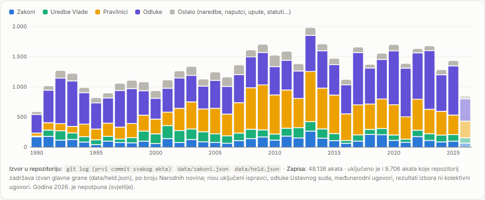

#### 2. Novi akti i izmjene

Za svako petogodište, koliko akata samo mijenja ili dopunjuje postojeći akt: 60 % zakona, 39 % uredaba Vlade, 38 % pravilnika i 19 % odluka.

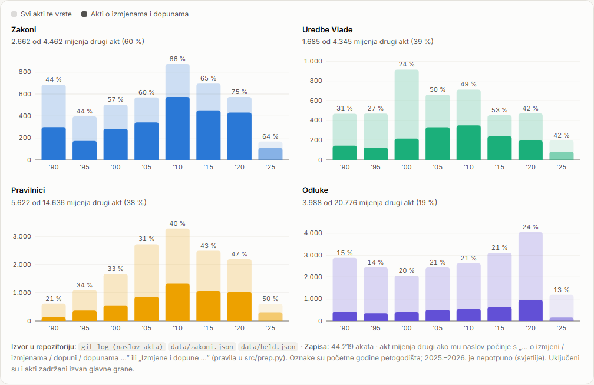

#### 3. O čemu su zakoni

Svaki zakon od 1990. po predmetu pročitanom iz naslova i po petogodištu: najčešće porezi, proračun i doprinosi (12 %).

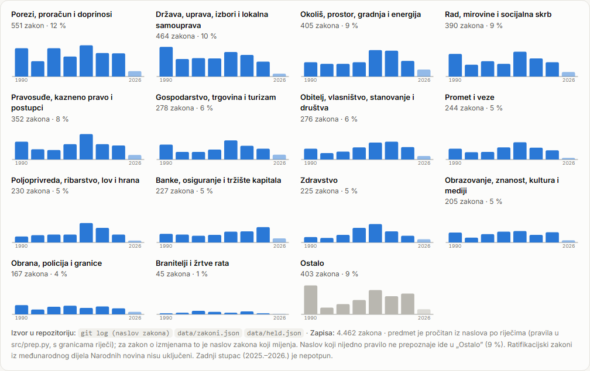

#### 4. Kalendar zakona

Zakoni po mjesecu i godini objave: u prosincu i srpnju, na kraju redovitih zasjedanja Sabora, objavi se 36 % zakona, u siječnju i kolovozu 2 %.

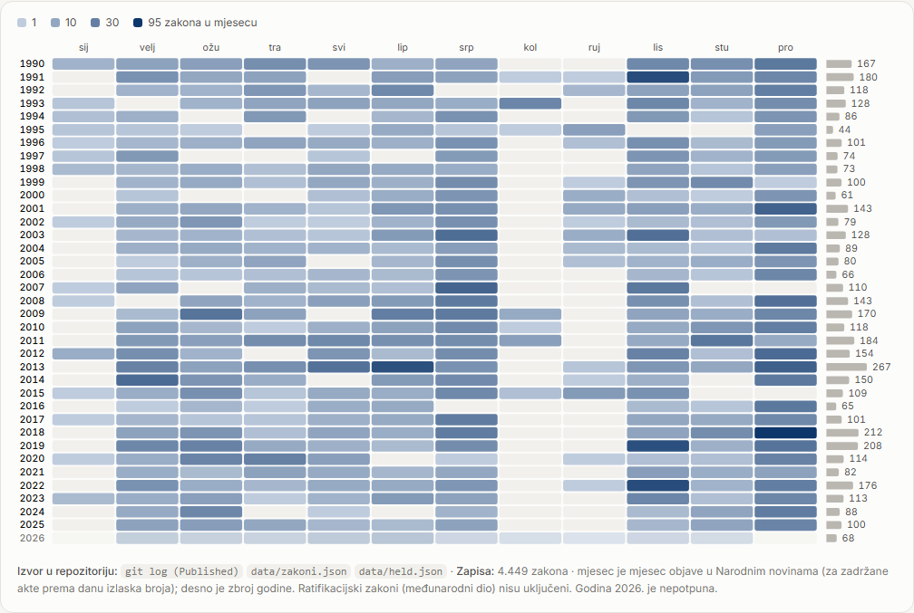

#### 5. Vlada mijenja zakone uredbom

Uredbe kojima Vlada, uz ovlast Sabora, mijenja ili dopunjuje zakon: od prosinca 2000. ih je 124, od toga 122 dok Sabor nije zasjedao.

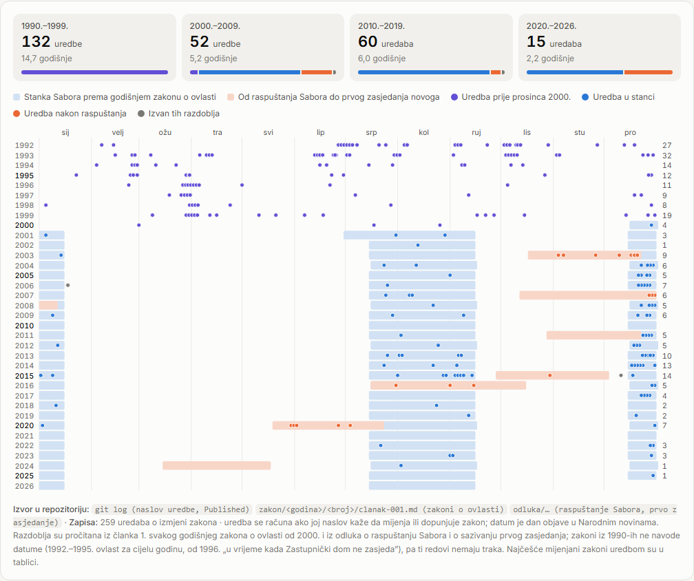

#### 6. Koliko su dugi zakoni

Broj članaka svakog novog zakona: medijan je narastao s 19 u 1990-ima na 43 od 2020.

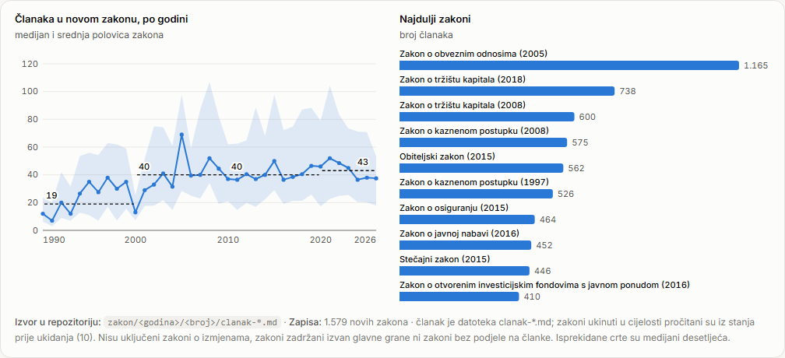

### II. Stupanje na snagu, izmjene i ispravci

#### 7. Kada zakoni stupaju na snagu

Razmak između objave i stupanja na snagu: 60 % zakona stupa na snagu osmi dan nakon objave, najranije što Ustav (čl. 90.) dopušta bez osobito opravdanih razloga.

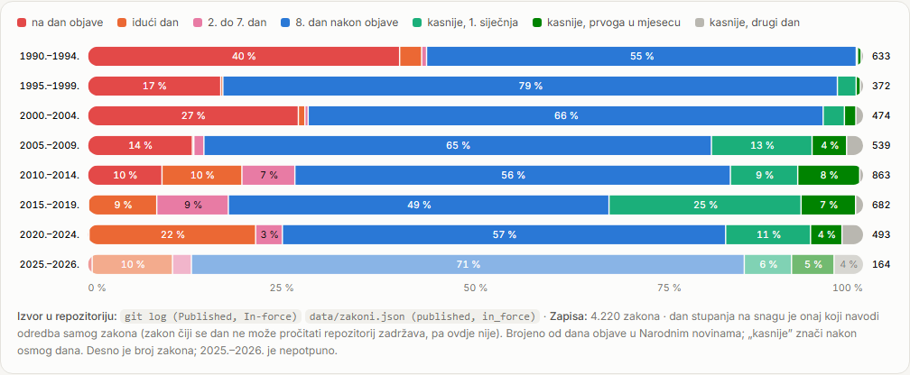

#### 8. Dani s najviše novih propisa

Petnaest dana na koje je na snagu stupilo najviše akata: 1. siječnja 2024. njih 438, većinom odluke općina i gradova o stopama poreza na dohodak.

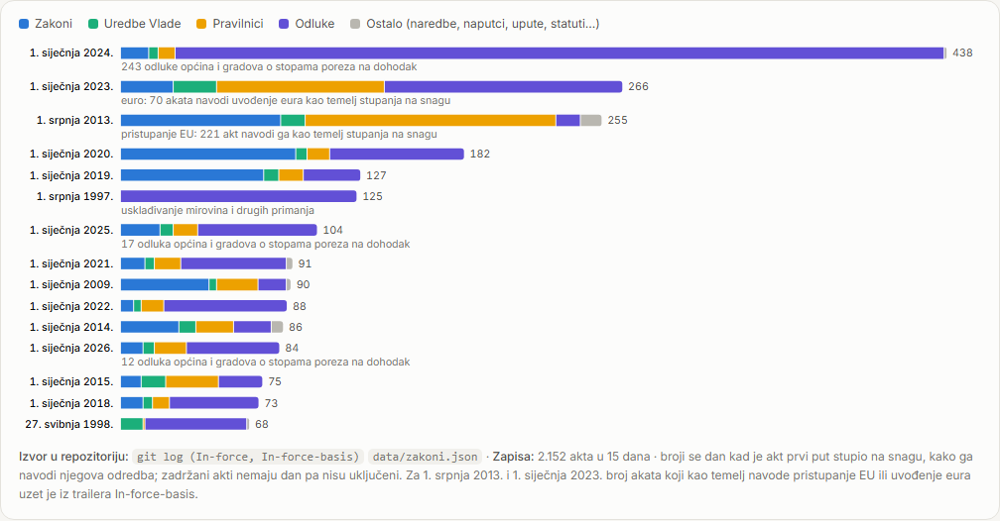

#### 9. Najčešće mijenjani zakoni

Izmjene i dopune najčešće mijenjanih zakona po godini: Zakon o porezu na dodanu vrijednost 28 puta od 1998.

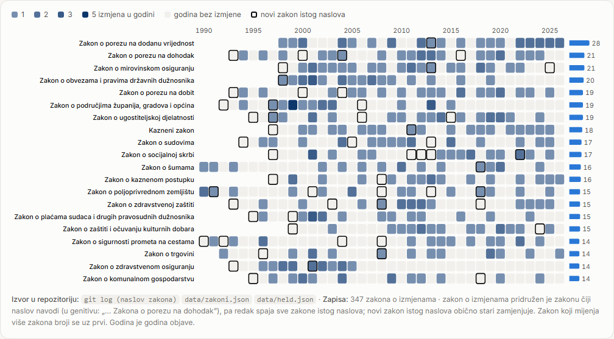

#### 10. Koliko brzo dolazi prva izmjena

Udio novih zakona koji još nisu izmijenjeni, po godinama od objave (Kaplan-Meierova procjena): polovica zakona iz 2000-ih i 2010-ih izmijenjena je unutar 4,5 godine.

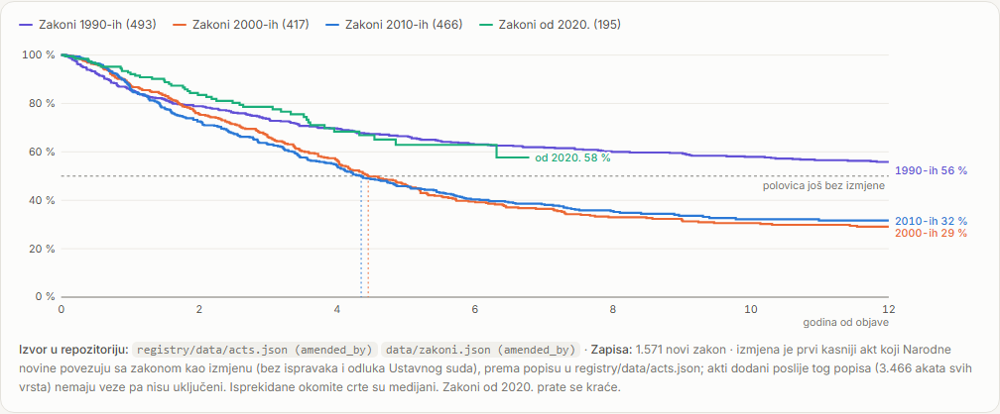

#### 11. Što je od zakona ostalo

Današnje stanje novih zakona svakog petogodišta: od zakona iz 2005.–2009. bez ikakve izmjene na snazi je 6 %.

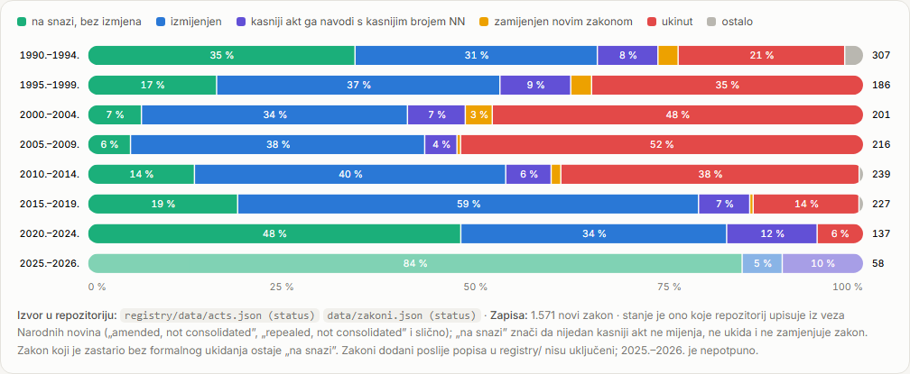

#### 12. Ispravci objavljenog teksta

Ispravci po godini i vrsti ispravljenog akta i koliko su kasnili: 1.526 ispravaka od 1990.; ispravak je dobio svaki 25. zakon.

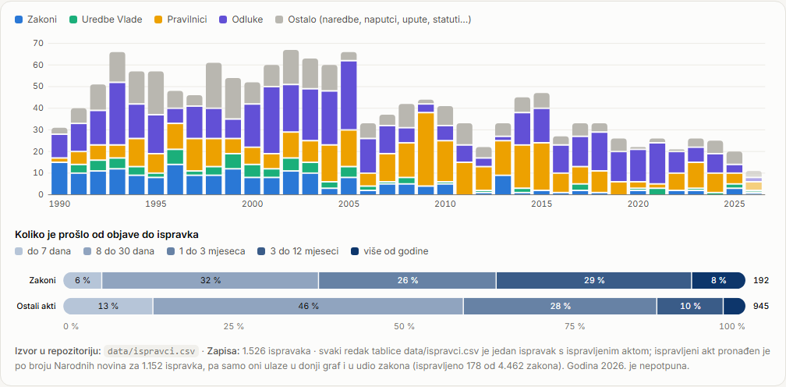

### III. Ustav, Ustavni sud i izbori

#### 13. Kako se mijenjao Ustav

Riječi dodane i izbrisane pri svakoj promjeni Ustava: najviše 2000. (+3.307 i −963), najmanje referendumom 2013. (+7).

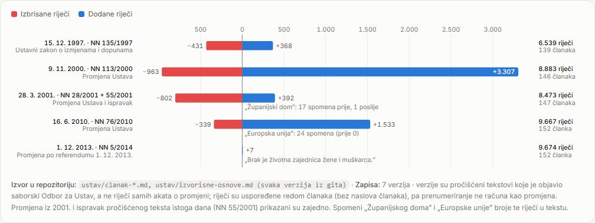

#### 14. Ustavni sud ukida odredbe

Odluke Ustavnog suda kojima se ukidaju ili poništavaju odredbe propisa, po godini i vrsti propisa (191 odluka, 78 o odredbama zakona), i popis zakona čije je odredbe Sud ukinuo od 2015.

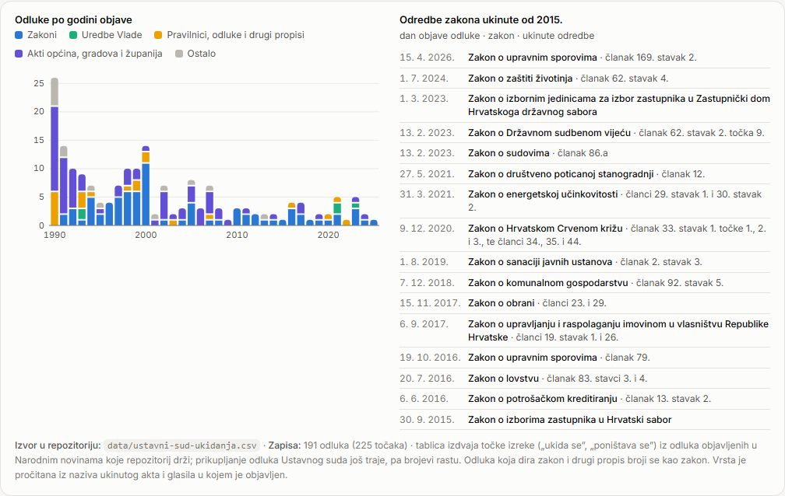

#### 15. Izlaznost na izborima za Sabor

Izlaznost u deset izbornih jedinica na svim izborima od 2003.: najniža 2020. (46,0 %), a 2024. ponovno 61,4 %.

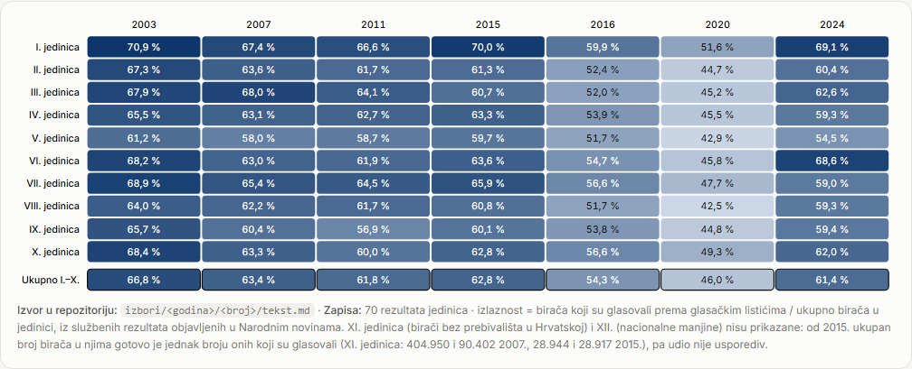

### IV. Europska unija i svijet

#### 16. Pravo EU u zakonima

Zakoni koji u prva tri članka navode direktive ili uredbe EU: od 2014. njih 38 %, a u godini pristupanja, 2013., 58 %.

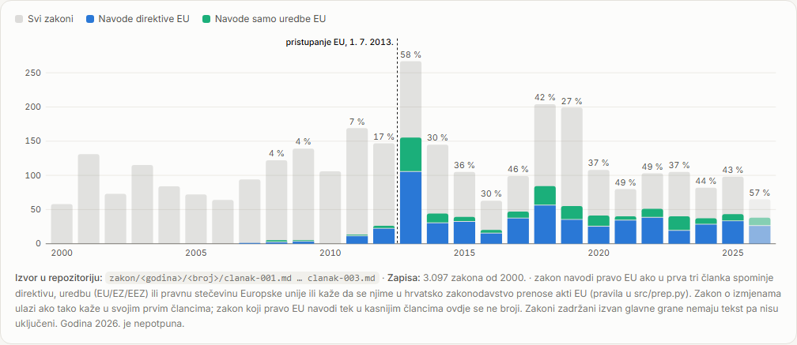

#### 17. S kim Hrvatska sklapa ugovore

Akti o međunarodnim ugovorima po drugoj ugovornoj strani, na karti i po desetljeću: najviše s Bosnom i Hercegovinom (49) i Mađarskom (48).

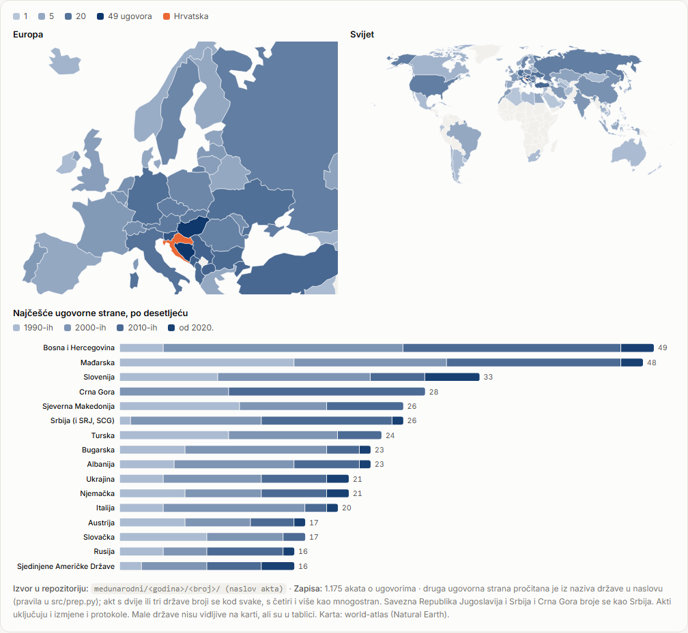

### V. Novac, porezi i obala

#### 18. Minimalna plaća u tri valute

Iznosi minimalne plaće iz akata Narodnih novina, preračunati u eure po tečajevima iz samih akata: od 8.170 dinara 1992. do 1.050 eura 2026.

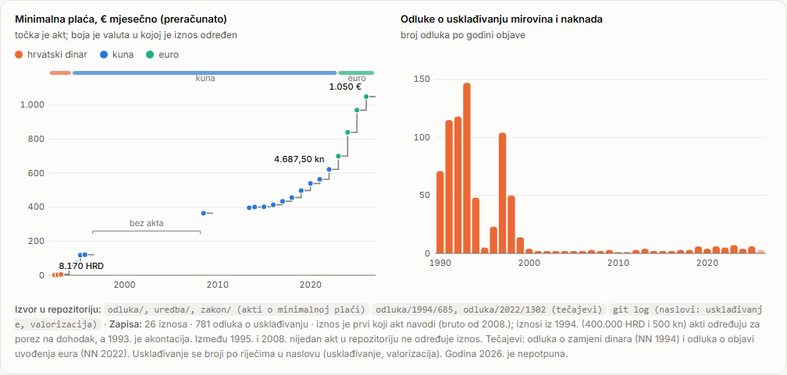

#### 19. Stope poreza na dohodak općina i gradova

Niža i viša stopa iz odluka općina i gradova na snazi od 1. siječnja 2024.: 59 % odluka određuje 20 % i 30 %.

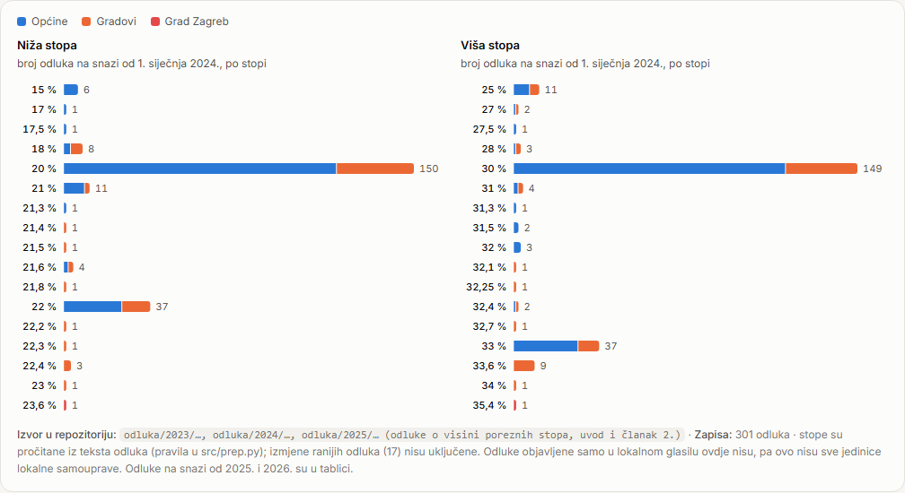

#### 20. Granica pomorskog dobra

Akti kojima se utvrđuje granica pomorskog dobra, na karti i po godini: 539 od 1996., najviše 2002. (126).

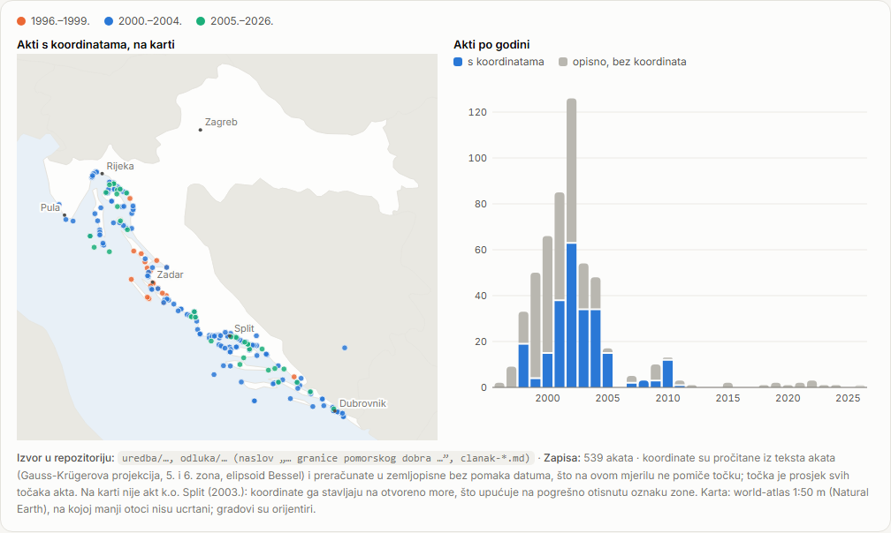

## Podaci

Stanje u commitu `52dec3c296` (16. studenoga 2026.).

| Skup podataka | Gdje je u repozitoriju | Zapisa | Obuhvat |
| --- | --- | ---: | --- |
| Povijest gita | grana `main` | 86.360 commitova | svaki akt ulazi jednim commitom pod svojim imenom, s danom objave (`Published:`) i stupanja na snagu (`In-force:`); datum commita je dan stupanja na snagu |
| Akti službenog dijela Narodnih novina | `<vrsta>/<godina>/<broj>/` | 37.685 akata | 1990.–2026.; akt je onako kako je prvi put tiskan, kasnije izmjene nisu unesene u njegov tekst |
| Zakoni iz ranije izrade | `data/zakoni.json` | 747 zakona | zakoni koji nisu i među aktima iznad |
| Zadržani akti | `data/held.json` | 9.706 akata | akti istih vrsta koje repozitorij zadržava izvan glavne grane: imaju broj i naslov, ali ne i tekst |
| Popis akata s vezama | `registry/data/acts.json` | 34.219 akata | stanje i kasniji akti koji mijenjaju, ukidaju, zamjenjuju ili citiraju svaki akt |
| Ustav | `ustav/` | 7 verzija | pročišćeni tekstovi 1990., 1997., 2000., 2001., 2010. i 2013. |
| Međunarodni ugovori | `medunarodni/` | 1.175 akata | 1992.–2026., akti o potvrđivanju i objavi |
| Ispravci | `data/ispravci.csv` | 1.526 | 1990.–2026. |
| Ukidanja Ustavnog suda | `data/ustavni-sud-ukidanja.csv` | 225 točaka izreke | odluke objavljene u Narodnim novinama; prikupljanje traje |
| Rezultati izbora | `izbori/` | 129 | Sabor 2003.–2024., predsjednik, Europski parlament |
| Sudska praksa | `caselaw/` | 45.278 odluka | Ustavni sud 14.008, Vrhovni sud 31.270 (1990.–1997.); učitavanje traje, nije u grafikonima |
| Lokalni propisi | `local/` | 183 akta | pilot: 13 jedinica Primorsko-goranske županije; nije u grafikonima |

## Ograničenja

- **Veze među aktima nisu potpune.** Grafikoni 10 i 11 čitaju izmjene i stanje zakona iz `registry/data/acts.json`; 3.466 akata dodanih poslije tog popisa još nema veze, pa nisu uključeni.
- **Zadržani akti nemaju teksta.** Grafikoni 1–4 i 9 broje i 9.706 zadržanih akata, po broju i naslovu iz Narodnih novina; grafikoni koji čitaju tekst ili dan stupanja na snagu ne mogu ih uključiti.
- **Kategorije su pročitane iz naslova.** Predmet zakona (graf 3), izmjene i dopune (2, 9), druga ugovorna strana (17) i akti o minimalnoj plaći i granici pomorskog dobra (18, 20) prepoznaju se po riječima naslova, prema pravilima u `src/prep.py`; što nijedno pravilo ne prepoznaje ide u „Ostalo”. Pravo EU (16) traži se samo u prva tri članka zakona.
- **Sudska praksa se još učitava.** Graf 14 prikazuje samo odluke Ustavnog suda o ukidanju objavljene u Narodnim novinama koje su do sada prikupljene; ostala sudska praksa u `caselaw/` nije u grafikonima.
- **Izbori:** graf 15 prikazuje deset izbornih jedinica na području Hrvatske; XI. (birači bez prebivališta u Hrvatskoj) i XII. (nacionalne manjine) nisu prikazane.
- **Minimalna plaća:** između 1995. i 2008. nijedan akt u repozitoriju ne određuje iznos; iznose iz 1994. akti određuju za porez na dohodak.
- **Pomorsko dobro:** granicu u koordinatama daje 243 od 539 akata; na karti ih je 242, jer je akt s pogrešno otisnutom oznakom zone izostavljen.
- **Djelomična razdoblja** (2026. i petogodište koje je obuhvaća) nacrtana su svjetlije.

## Ponovna izrada

```sh
python visualisations/src/make.py            # git log + tablice + tekstovi -> src/.build/ -> hrvatsko-pravo-u-20-grafikona.html
node visualisations/src/stills.cjs           # slike za ove README-e (treba Playwright; PLAYWRIGHT=<putanja> ako nije globalan)
```

`make.py` sve čita iz git objekata, pa radi i u blobless ili `--no-checkout` klonu: tekstove koje grafikoni čitaju (oko 16.000 malih datoteka) dohvaća u serijama. Zadano čita `origin/main` (ili `HEAD`); `--ref` bira drugu granu ili commit. U repozitorij ne piše ništa osim stranice i mape `src/.build/` (koju git zanemaruje).

| Datoteka | Što radi |
| --- | --- |
| `src/make.py` | izvlači povijest, tablice i tekstove u `src/.build/`, zatim pokreće `prep.py` i `build.py` |
| `src/prep.py` | računa sve brojeve za 20 grafikona i profil podataka u `src/.build/data.json` |
| `src/page.tpl.html` | stranica: tekst na oba jezika, grafikoni (d3), tablice |
| `src/build.py` | umeće `data.json` u predložak i piše stranicu |
| `src/stills.cjs` | crta svaki grafikon kao PNG u `stills/hr/` i `stills/en/` |

## Licencija

Vidi [`LICENSE`](../LICENSE). Opći uvjeti korištenja Narodnih novina kažu da se njihov sadržaj smije koristiti samo pod uvjetima propisanima zakonom i ne daju dozvolu za ponovnu objavu; [`registry/REPRODUCE.md`](../registry/REPRODUCE.md) oslanja se na Zakon o autorskom pravu i srodnim pravima (ZAPSP, čl. 18. st. 3.), prema kojem službeni tekstovi nisu zaštićeni. `LICENSE` ne daje nikakvu licenciju za tekst propisa, povijest ni alate dok se to pitanje ne riješi. Kratki citati propisa na stranici preuzeti su iz teksta u ovom repozitoriju, onako kako ga tiskaju Narodne novine.
