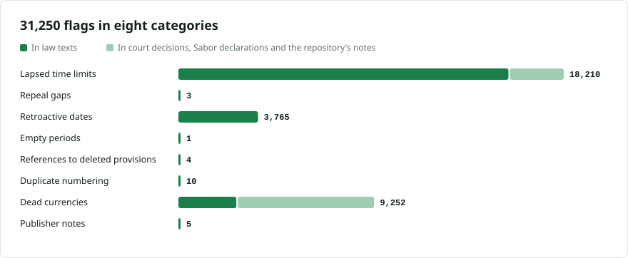

# Vulnerabilities in Croatian law

[Hrvatski](README.md) · **English**

<picture>
<source media="(prefers-color-scheme: dark)" srcset="img/flags-by-category-dark.svg">

</picture>

The vulnerability detectors from [lexifina/global-law](https://github.com/lexifina/global-law/tree/main/vulnerabilities) look for mechanical mistakes in legislation: a rule applying "until" a date that has passed, a time limit extended only after it had run out, a rule in force before it was published, a reference to an article that no longer exists. global-law's published list (9 November 2026) covered Croatia, with 8 flags, from an earlier copy of this repository, so this is a run over this repository only, as it stood at commit [`66edcff`](https://github.com/lexifina/croatia-law/commit/66edcffa67aca66469eb65b2e2edd1d1dda2abb3) on 15 November 2026, with the acts of Narodne novine, treaties, collective agreements, local acts and case law it now holds.

**In short:** the detectors raised 29,779 flags. A language model reviewed 125 of the strongest, arguing each one for and against; 10 survived. Checked by hand in this repository, none is a confirmed drafting mistake in Croatian national law. Two are local general acts, of a municipality and of a public water supplier, that, as printed here, took effect before they were published: the Tribunj municipal tax decision entered into force on 7 April 2010, the day it was adopted, and was printed in Narodne novine in May 2011; the Hvarski vodovod fee for water infrastructure applied from 1 July 2021 and was printed on 22 December 2021. Both have since been replaced. Of the other 8, 3 come from how this repository is built or dated, 4 are misreadings by a detector, and 1 is a spent rule. Later, this will be formalised in Lean, similar to our work on [the US tax code](https://lexifina.com/blog/formalizing-the-us-tax-code) and [US case law](https://lexifina.com/blog/formalizing-all-us-case-law-in-lean).

A flag is a prompt to look, not legal advice, and nothing here has been tested in court.

## Flags by category

| Category | What it looks for | Flags | In law texts | Reviewed | Survived review |
| --- | --- | ---: | ---: | ---: | ---: |
| Lapsed time limits | Text still applying a rule "until" a date that has passed | 16,689 | 14,667 | 40 | 2 |
| Repeal gaps | A provision left without text for a time and then restored | 3 | 3 | 3 | 1 |
| Retroactive or pre-publication dates | A rule in force before it was published | 3,765 | 3,765 | 40 | 3 |
| Empty periods | A time limit extended by an act that took effect after it had run out | 2 | 2 | 2 | 0 |
| References to deleted provisions | A provision citing an article that no longer exists | 57 | 57 | 40 | 4 |
| Duplicate numbering | Two units with the same number in one act | 10 | 10 | 0 | 0 |
| Dead currencies | Amounts in currencies no longer in use | 9,248 | 2,743 | 0 | 0 |
| Publisher notes | Notes that an amendment could not be carried out | 5 | 5 | 0 | 0 |

"In law texts" counts the Constitution, the acts of the official part of Narodne novine (laws, Government decrees, decisions, rules, orders, instructions and statutes), the laws of the earlier build, treaties, collective agreements and local acts. The other flags are in Supreme Court and Constitutional Court decisions, the Sabor's declarations and resolutions, and the repository's own notes, which this repository also holds. The searches for same-day conflicts and stale amounts found nothing to flag: most acts are held here as first printed, so a later amendment leaves their files as they were, and only the Constitution and the versions taken from official consolidated texts change over time; the one same-day pair, the Constitution's 2001 change and its correction (NN 55/2001), was not kept by the ranking.

*Edge cases: the 10 flags that survived the review, grouped by what they turned out to be, and what the other flags are, in [EDGE-CASES.en.md](EDGE-CASES.en.md).*

## Problems found in this repository

- **The root README is out of date.** Under "What it does not show" it says there are no local acts yet, but `local/` holds 119 acts of 2026 from twelve towns and municipalities (Krk, Rab, Mali Lošinj and nine others). It says that only Constitutional Court decisions published in Narodne novine are here, but `caselaw/vrhovni-sud/` holds 7,683 Supreme Court decisions, nearly all from 1990 and 1991, and `ustavni-sud/` holds 1,909 records without text from the Court's own database beside its 1,141 decisions. `corpus.json` still describes a corpus of the Constitution alone, with a record ending on 1 December 2013, and `LICENSE` says the repository is private and speaks only of the Constitution's text; the repository is public.
- **Wrong years in some dates of adoption.** An act that takes effect on the day it is made is dated by the date the gazette prints above the signature, so a misprinted year moves it by a decade: Odluka o inozemnim uredima Republike Hrvatske (NN 21/1991) is dated 18 January 1981, though its preamble says it was made "dana 18. siječnja 1991.", and Odluka o osnivanju Veleposlanstva Republike Hrvatske u Republici Turskoj (NN 9/1993) is dated 18 January 1983. Two Government decisions in NN 42/2025, on the [Nacionalno vijeće za održivi razvoj](https://github.com/lexifina/croatia-law/commit/6d905df18642059c62d36b1705b49e1a8d0b1e8f) and the [Savjet za razvoj civilnoga društva](https://github.com/lexifina/croatia-law/commit/8a11f239a2208dc4f4ea74fa7ff6e62866f582bf), are dated 7 March 2024, while their preambles say they were made at the Government's session of 7 March 2025 (the gazette prints that date above the signature of the first). In a sample of 317 laws, decrees and rules, the date of entry into force matched each act's own entry-into-force sentence every time.
- **Several articles in one file.** [pravilnik/2014/801/clanak-009.md](https://github.com/lexifina/croatia-law/blob/66edcffa67aca66469eb65b2e2edd1d1dda2abb3/pravilnik/2014/801/clanak-009.md) holds Articles 9, 11 and 12 (the gazette prints no Article 10), and [uredba/2018/1843/clanak-028.md](https://github.com/lexifina/croatia-law/blob/66edcffa67aca66469eb65b2e2edd1d1dda2abb3/uredba/2018/1843/clanak-028.md) holds Article 28 and Articles 30 to 48, so those articles have no file of their own and no history of their own.
- **Folders outside the layout:** ten top-level folders named `naputak-<year>-<number>` (for example `naputak-1995-17`); five repeat an act also held in `naputak/<year>/<number>/`, and five are held only there.
- **Decisions about named people:** each act's README says that decisions about named people (appointments, dismissals, pardons, decorations, citizenship) are left out, but `odluka/` holds 329 decisions of 2013 to 2026 appointing named ambassadors, honorary consuls and representatives (Odluka o postavljanju ...).

## Files

| File | What it holds |
| --- | --- |
| [data/flags.csv](data/flags.csv) | Every flag, one row per provision and issue |
| [data/reviewed.csv](data/reviewed.csv) | The 125 flags the model reviewed, with its verdict and reason |
| [data/by_category.csv](data/by_category.csv) | The counts in the table above |
| [tools/](tools/) | The scripts that made this run |

Columns: `category` and `category_hr` (the category in English and Croatian), `detector`, `kind` (`law` or `other`), `path` (the file in this repository), `date` (the date the flag turns on), `reference` (the act or line involved), `summary`, `score` (the detector's ranking, 0 to 1), `review` (`artefact`, `lawful` or `candidate_defect`), `survives_rebuttal`, `review_note` (the model's reason, in English), `url` (the provision at the commit that was read, or, for one removed since, at the last commit that held it; for retroactive dates, the commit that added the act).

## How it was made

- **Detectors:** global-law's [vulnerabilities/scripts](https://github.com/lexifina/global-law/tree/main/vulnerabilities/scripts), run on this repository at commit `66edcff`. global-law replays this repository only up to an earlier commit, so the history table the detectors read was built from this repository's own commits (the author, that is the act that made each change, and the `Law`, `In-force` and `Kind` trailers), counting as law changes the acts marked `law`, `decree`, `as-enacted`, `Zakon` and `treaty`, the versions from official consolidated texts (`publisher`) and the Constitution's changes.
- **Model review:** gpt-5.4-mini, the 40 strongest flags per category, and for lapsed time limits also the 40 strongest in law texts (here the same 40); one pass says whether a flag is real, a second argues that it is not. Empty periods use global-law's own review for that category, on both flags, followed by the same second pass. global-law's own list used a different model.
- **Hand check:** every case that survived was read in this repository's history and texts, with the amending act where this repository holds it; the dates of five acts were checked on Narodne novine's own pages. The two open cases still need the county gazette and Hvarski vodovod's own publications, which this repository does not hold.

To report a correction, open an issue with the provision and an official source.

## Licence

The lists and notes are Lexifina's and fall under the same terms as the rest of this repository's own contributions: until the question that [LICENSE](../LICENSE) describes is settled, no licence is granted for them. Quoted law text is as Narodne novine prints it.
