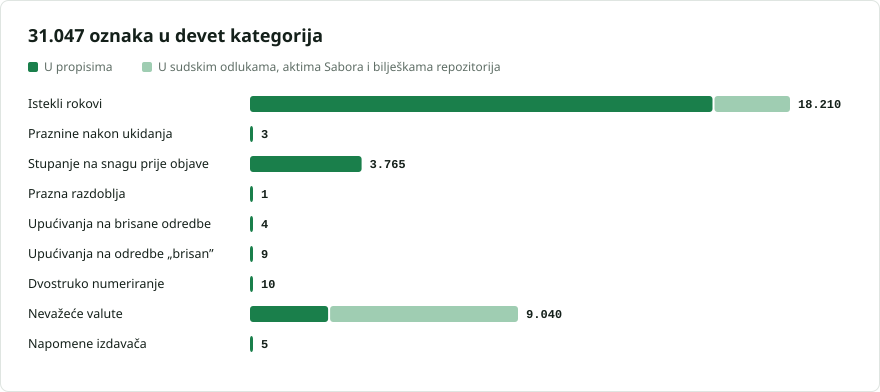

# Ranjivosti u hrvatskim propisima

**Hrvatski** · [English](README.en.md)

<picture>
<source media="(prefers-color-scheme: dark)" srcset="img/flags-by-category-dark.hr.svg">

</picture>

Detektori ranjivosti iz repozitorija [lexifina/global-law](https://github.com/lexifina/global-law/tree/main/vulnerabilities) traže mehaničke pogreške u propisima: pravilo koje se i dalje primjenjuje „do” datuma koji je prošao, rok produljen tek nakon što je istekao, propis koji je stupio na snagu prije nego što je objavljen, upućivanje na članak kojeg više nema. Popis koji je global-law objavio 9. studenoga 2026. obuhvatio je Hrvatsku s 8 oznaka, i to prema starijoj kopiji ovog repozitorija. Ovo je stoga provjera samo ovog repozitorija, u stanju commita [`66edcff`](https://github.com/lexifina/croatia-law/commit/66edcffa67aca66469eb65b2e2edd1d1dda2abb3) od 15. studenoga 2026., s aktima Narodnih novina, međunarodnim ugovorima, kolektivnim ugovorima, lokalnim propisima i sudskom praksom koje sada sadrži.

**Ukratko:** detektori su dali 31.047 oznaka. Jezični model pregledao je 184 najjače i za svaku iznio argumente za i protiv; 7 ih je izdržalo pregled. Nakon ručne provjere u ovom repozitoriju nijedna nije potvrđena pogreška u hrvatskom državnom zakonodavstvu. Dvije se odnose na opće akte lokalne razine, jedne općine i jednog javnog isporučitelja vodnih usluga, koji su, kako su ovdje tiskani, stupili na snagu prije objave: odluka o općinskim porezima Općine Tribunj stupila je na snagu 7. travnja 2010., na dan donošenja, a u Narodnim novinama tiskana je u svibnju 2011.; naknada za razvoj komunalnih vodnih građevina Hvarskog vodovoda primjenjivala se od 1. srpnja 2021., a tiskana je 22. prosinca 2021. Obje su odluke u međuvremenu zamijenjene. Od preostalih 5 oznaka 2 proizlaze iz načina na koji je ovaj repozitorij izrađen ili datiran, 2 su pogrešna čitanja detektora, a 1 je obveza ispunjena u roku: izmjenama zakona o tržištu plina iz 2017. Vladi je naloženo da do 1. travnja 2017. odredi cijenu plina za kućanstva, što je i učinila 28. veljače 2017. Među 9 upućivanja na odredbe „brisan”, ručno pročitanih, jedno je upućivanje koje je izmjena zaboravila uskladiti: članak 79. Zakona o sudovima iz 2005. i dalje je upućivao na članak 102. nakon što ga je izmjena iz 2010. brisala, sve dok zakon nije zamijenio novi Zakon o sudovima 2013.; od ostalih 8 tri su u iscrpljenim ili prijelaznim odredbama, tri su sama ukidanja, a dva su pogrešno pročitana. Kasnije će ovo biti formalizirano u Leanu, slično našem radu na [poreznom zakoniku SAD-a](https://lexifina.com/blog/formalizing-the-us-tax-code) i [sudskoj praksi SAD-a](https://lexifina.com/blog/formalizing-all-us-case-law-in-lean).

Oznaka je poziv da se nešto pogleda, a ne pravni savjet, i ništa od ovoga nije provjereno pred sudom.

## Oznake po kategorijama

| Kategorija | Što traži | Oznake | U propisima | Pregledano | Izdržalo pregled |
| --- | --- | ---: | ---: | ---: | ---: |
| Istekli rokovi | Tekst koji se i dalje primjenjuje „do” datuma koji je prošao | 18.210 | 15.597 | 136 | 1 |
| Praznine nakon ukidanja | Odredba koja je neko vrijeme bila bez teksta, a zatim je vraćena | 3 | 3 | 3 | 1 |
| Stupanje na snagu prije objave | Propis koji je na snazi prije nego što je objavljen | 3.765 | 3.765 | 40 | 3 |
| Prazna razdoblja | Rok produljen aktom koji je stupio na snagu nakon što je rok istekao | 1 | 1 | 1 | 1 |
| Upućivanja na brisane odredbe | Odredba koja upućuje na članak kojeg više nema | 4 | 4 | 4 | 1 |
| Upućivanja na odredbe „brisan” | Odredba koja upućuje na članak čiji je jedini tekst „Brisan.” ili „prestao važiti” | 9 | 9 | 0 | 0 |
| Dvostruko numeriranje | Dvije jedinice s istim brojem u jednom aktu | 10 | 10 | 0 | 0 |
| Nevažeće valute | Iznosi u valutama koje više nisu u uporabi | 9.040 | 2.635 | 0 | 0 |
| Napomene izdavača | Napomene da izmjena nije mogla biti unesena | 5 | 5 | 0 | 0 |

„U propisima” obuhvaća Ustav, akte službenog dijela Narodnih novina (zakone, uredbe Vlade, odluke, pravilnike, naredbe, naputke, upute i statute), zakone iz ranije izrade, međunarodne ugovore, kolektivne ugovore i lokalne propise. Ostale su oznake u odlukama Vrhovnog suda i Ustavnog suda, u deklaracijama i rezolucijama Hrvatskoga sabora te u vlastitim bilješkama repozitorija, koje ovaj repozitorij također sadrži. Potraga za izmjenama istoga dana i za zastarjelim iznosima nije našla ništa: većina je akata ovdje onakva kako je prvi put tiskana, pa kasnija izmjena ne mijenja njihove datoteke, a kroz vrijeme se mijenjaju samo Ustav i verzije preuzete iz službenih pročišćenih tekstova; jedini par izmjena istoga dana, promjena Ustava iz 2001. i njezin ispravak (NN 55/2001), rangiranje nije zadržalo. Potraga za upućivanjima na odredbe „brisan”, koja sada broj članka čita i iz naziva datoteke `clanak-N`, pronašla je 9 takvih upućivanja u četiri akta; potraga za kaznama bez obilježja prekršaja nije pronašla ništa.

*Granični slučajevi: 7 oznaka koje su izdržale pregled, razvrstanih prema tome što su se pokazale, 9 upućivanja na odredbe „brisan” i što su ostale oznake, u [EDGE-CASES.md](EDGE-CASES.md).*

## Problemi pronađeni u ovom repozitoriju

- **Glavni README nije ažuran.** U odjeljku „Što ne prikazuje” navodi da lokalnih propisa zasad nema, a `local/` sadrži 119 akata iz 2026. dvanaest gradova i općina (Krk, Rab, Mali Lošinj i još devet). Navodi da su ovdje samo odluke Ustavnog suda objavljene u Narodnim novinama, a `caselaw/vrhovni-sud/` sadrži 7.683 odluke Vrhovnog suda, gotovo sve iz 1990. i 1991., dok `ustavni-sud/` uz 1.141 odluku sadrži i 1.909 zapisa bez teksta iz baze samog Suda. `corpus.json` i dalje opisuje korpus koji obuhvaća samo Ustav, sa zapisom do 1. prosinca 2013., a `LICENSE` navodi da je repozitorij privatan i govori samo o tekstu Ustava; repozitorij je javan.
- **Pogrešne godine u nekim datumima donošenja.** Akt koji stupa na snagu danom donošenja datiran je prema datumu koji Narodne novine tiskaju iznad potpisa, pa ga pogrešno otisnuta godina pomiče za desetljeće: Odluka o inozemnim uredima Republike Hrvatske (NN 21/1991) datirana je 18. siječnja 1981., iako u uvodu stoji da je donesena „dana 18. siječnja 1991.”, a Odluka o osnivanju Veleposlanstva Republike Hrvatske u Republici Turskoj (NN 9/1993) 18. siječnja 1983. Dvije odluke Vlade iz NN 42/2025, o [Nacionalnom vijeću za održivi razvoj](https://github.com/lexifina/croatia-law/commit/6d905df18642059c62d36b1705b49e1a8d0b1e8f) i o [Savjetu za razvoj civilnoga društva](https://github.com/lexifina/croatia-law/commit/8a11f239a2208dc4f4ea74fa7ff6e62866f582bf), datirane su 7. ožujka 2024., iako u njihovim uvodima stoji da ih je Vlada donijela na sjednici održanoj 7. ožujka 2025. (Narodne novine taj datum tiskaju i iznad potpisa prve). U uzorku od 317 zakona, uredaba i pravilnika dan stupanja na snagu svaki se put podudarao s vlastitom odredbom akta o stupanju na snagu.
- **Više članaka u jednoj datoteci.** [pravilnik/2014/801/clanak-009.md](https://github.com/lexifina/croatia-law/blob/66edcffa67aca66469eb65b2e2edd1d1dda2abb3/pravilnik/2014/801/clanak-009.md) sadrži članke 9., 11. i 12. (Narodne novine ne tiskaju članak 10.), a [uredba/2018/1843/clanak-028.md](https://github.com/lexifina/croatia-law/blob/66edcffa67aca66469eb65b2e2edd1d1dda2abb3/uredba/2018/1843/clanak-028.md) članak 28. i članke 30. do 48., pa ti članci nemaju vlastitu datoteku ni vlastitu povijest.
- **Mape izvan rasporeda:** deset mapa na najvišoj razini nazvanih `naputak-<godina>-<broj>` (na primjer `naputak-1995-17`); pet ponavlja akt koji je i u `naputak/<godina>/<broj>/`, a pet postoji samo ondje.
- **Odluke o imenovanim osobama:** README svakog akta navodi da su odluke o imenovanim osobama (imenovanja, razrješenja, pomilovanja, odlikovanja, državljanstvo) izostavljene, a `odluka/` sadrži 329 odluka iz razdoblja od 2013. do 2026. o postavljanju imenovanih veleposlanika, počasnih konzula i predstavnika (Odluka o postavljanju ...).

## Datoteke

| Datoteka | Što sadrži |
| --- | --- |
| [data/flags.csv](data/flags.csv) | Sve oznake, jedan redak po odredbi i problemu |
| [data/reviewed.csv](data/reviewed.csv) | 184 oznake koje je model pregledao, s ocjenom i obrazloženjem |
| [data/by_category.csv](data/by_category.csv) | Brojevi iz tablice iznad |
| [tools/](tools/) | Skripte kojima je provjera provedena |

Stupci: `category` i `category_hr` (kategorija na engleskom i hrvatskom), `detector`, `kind` (`law` za propis ili `other`), `path` (datoteka u ovom repozitoriju), `date` (datum na koji se oznaka odnosi), `reference` (akt ili redak o kojem je riječ), `summary`, `score` (rangiranje detektora, od 0 do 1), `review` (`artefact` za pogrešku u podacima, `lawful` za zakonito ili `candidate_defect` za moguću pogrešku), `survives_rebuttal`, `review_note` (obrazloženje modela, na engleskom), `url` (odredba u pročitanom commitu ili, za odredbu koja je u međuvremenu uklonjena, u posljednjem commitu koji ju je sadržavao; za stupanje na snagu prije objave, commit kojim je akt dodan).

## Kako je provjera provedena

- **Detektori:** [vulnerabilities/scripts](https://github.com/lexifina/global-law/tree/main/vulnerabilities/scripts) iz repozitorija global-law, pokrenuti nad ovim repozitorijem u commitu `66edcff`. global-law ovaj repozitorij ponavlja samo do starijeg commita, pa je tablica povijesti koju detektori čitaju izrađena iz vlastitih commitova ovog repozitorija (autor, odnosno akt koji je unio promjenu, te traileri `Law`, `In-force` i `Kind`), pri čemu se kao promjene propisa računaju akti označeni s `law`, `decree`, `as-enacted`, `Zakon` i `treaty`, verzije iz službenih pročišćenih tekstova (`publisher`) i promjene Ustava.
- **Ponovljena provjera:** detektori su ponovno pokrenuti s ispravcima za hrvatske datume („studenog”, datumi pisani s razmacima, „do kraja <godina>. godine”, „zaključno s <datum>”, „do dana <datum>”, „listopada” kao listopad te „najkasnije” kao oznaka krajnjeg roka), za hrvatske nazive datoteka i naslove članaka koji slijede iza naslova glave u upućivanjima te za nazive valuta; istekli rokovi, upućivanja na brisane odredbe i prazna razdoblja ponovno su pregledani. Podjela pretraživanja upućivanja na usporedne dijelove isprva je neke akte izostavila (pronašla je 2 od 4 upućivanja na brisane odredbe); to je ispravljeno i provjera ponovljena.
- **Posljednja provjera:** svi su koraci ponovljeni s najnovijim ispravcima, uz zadržavanje već obavljenih pregleda. Potraga za upućivanjima na odredbe „brisan” nije bila ponovno pokrenuta otkad detektori čitaju nazive datoteka `clanak-N`, pa dotad nije ništa pronalazila; „brisan” sada čita samo kao cijelu riječ. Pretraživanje valuta sada čita „lati” i „latu” (latvijsku valutu) samo kao zasebne riječi, „BEF” samo velikim slovima, a španjolski „marco” samo malim slovima, čime je otpalo 212 lažnih pogodaka. Pregledi se s oznakama sparuju prema 400 znakova konteksta, a ne prema 80.
- **Pregled modelom:** gpt-5.4-mini, 40 najjačih oznaka po kategoriji, a za istekle rokove i 40 najjačih u propisima; jedan prolaz ocjenjuje je li oznaka stvarna, drugi iznosi argumente da nije. U kasnijim provjerama oko 8.900 isteklih rokova ima najvišu ocjenu, pa su pregledani u više krugova, pri čemu su zadržani već obavljeni pregledi, a modelu su svaki put upućene najjače dotad nepregledane oznake; 136 tih pregleda odgovara sadašnjim oznakama, sve u propisima; 20 ih je obavljeno u posljednjoj provjeri. Za prazna razdoblja upotrijebljen je vlastiti pregled global-lawa za tu kategoriju, nakon čega slijedi isti drugi prolaz. Vlastiti popis global-lawa izrađen je drugim modelom.
- **Ručna provjera:** svaki slučaj koji je izdržao pregled pročitan je u povijesti i tekstovima ovog repozitorija, zajedno s aktom o izmjeni ako ga repozitorij sadrži, kao i 9 upućivanja na odredbe „brisan”; datumi pet akata provjereni su na stranicama Narodnih novina, a bilješka uz Zakon o državnim službenicima prema ondje objavljenom pročišćenom tekstu NN 49/2012. Za dva otvorena slučaja potrebni su još službeni vjesnik županije i objave samog Hvarskog vodovoda, koje ovaj repozitorij ne sadrži.

Ispravak možete prijaviti otvaranjem issuea s odredbom i službenim izvorom.

## Licencija

Popisi i bilješke djelo su Lexifine i podliježu istim uvjetima kao i ostali vlastiti doprinosi ovog repozitorija: dok se ne riješi pitanje koje opisuje [LICENSE](../LICENSE), za njih se ne daje nikakva licencija. Citirani tekst propisa onakav je kakvim ga tiskaju Narodne novine.

Ovo je prijevod engleske verzije ([README.en.md](README.en.md)); ako se razlikuju, mjerodavna je engleska verzija.
